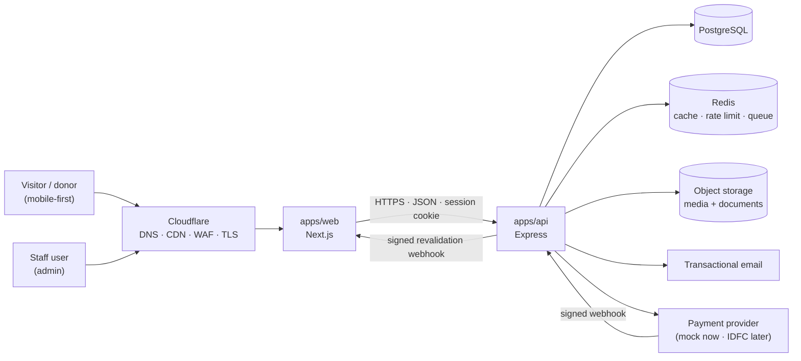
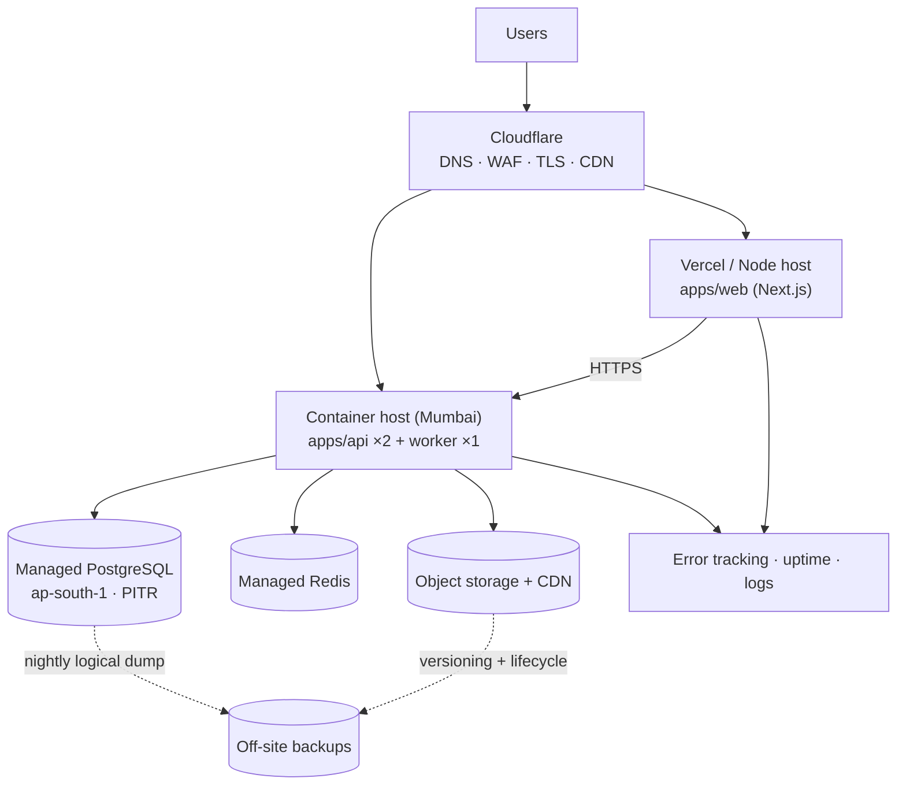

# Architecture — Shri Vanshidhar Gaushala

**Document status:** Phase 1 deliverable — awaiting approval
**Version:** 1.0 (proposal)
**Source of truth:** `docs/Shri_Vanshidhar_Gaushala_Updated_Warm_Earth_Tone_Blueprint.docx`
**Last updated:** 2026-11-05
**Companion documents:** `DATABASE_DESIGN.md`, `API_DESIGN.md`, `SECURITY_PLAN.md`, `SEO_PLAN.md`, `IMPLEMENTATION_PLAN.md`

> Nothing in this document authorises implementation. Every decision marked **⏳ APPROVAL REQUIRED** must be confirmed before Phase 2 begins.

---

## Table of contents

1. [Purpose and scope](#1-purpose-and-scope)
2. [Governing principles](#2-governing-principles)
3. [System overview](#3-system-overview)
4. [Recommended technology stack](#4-recommended-technology-stack)
5. [Architecture decision records](#5-architecture-decision-records)
6. [Repository and folder structure](#6-repository-and-folder-structure)
7. [Backend module structure](#7-backend-module-structure)
8. [Frontend architecture and route maps](#8-frontend-architecture-and-route-maps)
9. [CMS content model and publishing workflow](#9-cms-content-model-and-publishing-workflow)
10. [RBAC permission matrix](#10-rbac-permission-matrix)
11. [Donation and payment architecture](#11-donation-and-payment-architecture)
12. [Media storage architecture](#12-media-storage-architecture)
13. [SEO architecture](#13-seo-architecture)
14. [Design system foundation](#14-design-system-foundation)
15. [Environments and configuration](#15-environments-and-configuration)
16. [Deployment architecture](#16-deployment-architecture)
17. [Observability and operations](#17-observability-and-operations)
18. [Non-functional requirements](#18-non-functional-requirements)
19. [Out of scope for the first release](#19-out-of-scope-for-the-first-release)
20. [Phase 1 summary and approvals requested](#20-phase-1-summary-and-approvals-requested)

---

## 1. Purpose and scope

This document defines the technical architecture for the Shri Vanshidhar Gaushala website: a premium public website with strong SEO foundations, a database-driven CMS an authorised non-technical team can operate without code changes, a donation management system that stays payment-provider-independent until the IDFC FIRST Bank integration is officially documented, and a security posture appropriate for a site that will accept real donations.

### In scope

- Public website (20 information-architecture routes plus system routes)
- Admin dashboard and CMS (content, media, enquiries, donations, SEO, settings, users, audit)
- Multi-user authentication with configurable role-based permissions
- Donation domain with a provider adapter contract and a development-only mock provider
- SEO architecture: metadata, sitemap, robots, redirects, structured data
- Security, accessibility, performance and operational foundations

### Explicitly not decided here

- The exact IDFC FIRST Bank integration flow. Provider endpoints, payload formats, signatures and webhook behaviour are **not** invented in this document. A contract boundary is defined; the implementation waits for official merchant documentation and sandbox credentials.
- Any Gaushala fact: registration numbers, years of operation, impact figures, testimonials, addresses, phone numbers, tax status. All such values are treated as **content supplied by the organisation** (Phase 10).

---

## 2. Governing principles

These are taken from the blueprint's project-principle table and drive every decision below.

| Principle | Architectural consequence |
|---|---|
| **Modular monolith**, not microservices | One deployable API with strict internal module boundaries and one-directional dependencies. No service mesh, no message broker beyond a job queue. |
| **Database-driven content** | No editable copy, statistic, campaign detail, contact value or image path lives in a React component. Content reaches the browser through the API. |
| **Provider-independent payments** | The donation domain never imports a provider SDK. Providers are adapters behind an interface. |
| **Instant publishing for authorised roles** | Publish triggers on-demand cache revalidation; no redeploy, no rebuild. |
| **Truthfulness** | The data model encodes verification state (impact statistics, testimonials) rather than trusting free text. Unverified content cannot reach production pages. |
| **Deny by default** | Every API route declares an explicit permission; public access is an explicit declaration, not an omission. |
| **Accessible, responsive, fast** | Server-rendered HTML, semantic markup, WCAG 2.2 AA targets, mobile-first layouts, performance budgets enforced in CI. |

---

## 3. System overview

### 3.1 Context



### 3.2 Containers

| Container | Responsibility | Runtime |
|---|---|---|
| `apps/web` | Public site (SSR/ISR) and admin UI. Owns presentation, routing, metadata rendering, client-side forms. Never talks to the database directly. | Node.js (Next.js server) + Edge middleware |
| `apps/api` | All business logic, authorisation, validation, persistence, payment reconciliation, scheduled publishing. | Node.js (Express) |
| `apps/api` worker | Background jobs: scheduled publishing, transactional email, media post-processing, payment reconciliation, retention cleanup. Separate process, same codebase. | Node.js |
| `packages/shared` | Cross-cutting contracts: Zod schemas, permission constants, enums, money/date/slug utilities, design tokens. | Compiled TS library |
| PostgreSQL | System of record. | Managed service |
| Redis | Rate-limit counters, short-lived cache, BullMQ queues, session lookup acceleration. | Managed service |
| Object storage | Original media, derivatives, generated receipt PDFs, private documents. | S3-compatible |
| Cloudflare | TLS, CDN, WAF, DDoS, bot management. | Managed |

### 3.3 Why two applications rather than Next.js API routes only

The blueprint recommends Express as the backend and a versioned REST API. Beyond following the source of truth, the split buys:

- A single authorisation surface. Every privileged operation passes through one middleware chain (session → permission → CSRF → rate limit → validate → audit) instead of being spread across route handlers and server actions.
- The donation domain can be integrated and tested without the rendering layer, and the payment webhook endpoint has no Next.js lifecycle concerns.
- A separate worker process (scheduled publishing, payment reconciliation) is natural in an Express codebase and awkward inside a Next.js app.
- Future consumers (a mobile app, a partner portal) reuse the same API.

**Cost accepted:** an extra network hop (~1–5 ms inside the same region) on server-rendered requests. Mitigated by request-scoped caching and by keeping the web server colocated with the API region.

---

## 4. Recommended technology stack

**⏳ APPROVAL REQUIRED — D-01, D-02**

Versions are deliberately given as families. Exact versions are pinned at the start of Phase 2 after confirming the current stable release and its support status; pinning a stale version now would create avoidable upgrade work.

| Layer | Recommendation | Rationale |
|---|---|---|
| **Frontend** | **Next.js (App Router) + React + TypeScript** | The blueprint requires server-side rendering or pre-rendering so crawlers and social scrapers receive meaningful HTML. The App Router provides per-route SSR/ISR, the Metadata API for per-page SEO, `sitemap.ts`/`robots.ts` conventions, streaming, route groups for the protected admin area, and `next/image` with custom loaders for the R2/CDN media pipeline. |
| **Styling** | **Tailwind CSS v4** with CSS custom properties as design tokens | Utility-first keeps the component surface small; v4's `@theme` maps directly onto the blueprint's palette tokens; no runtime CSS-in-JS cost. |
| **Backend** | **Node.js (current LTS) + Express 5 + TypeScript** | Blueprint recommendation. Mature middleware ecosystem for the exact concerns this project needs (sessions, CSRF, rate limiting, request validation, structured logging). Express 5's native async error propagation removes the main historical footgun. |
| **Database** | **PostgreSQL 16+** | See ADR-003 and `DATABASE_DESIGN.md` for the full comparison. |
| **ORM** | **Prisma** | See ADR-004. Type-safe client, declarative schema, reviewable SQL migrations, first-class PostgreSQL support, transactions and raw-SQL escape hatch where Prisma is weak (partial indexes, triggers, report views). |
| **Validation** | **Zod** (schemas shared between API and web through `packages/shared`) | One schema is the request contract, the TypeScript type and the OpenAPI source. Prevents client/server drift. |
| **Authentication** | **Server-managed opaque sessions** in PostgreSQL, `HttpOnly` + `Secure` + `SameSite=Lax` cookie, **Argon2id** password hashing, optional **TOTP MFA** | See ADR-005. No tokens in `localStorage`; instant revocation; no JWT key-rotation or revocation-list complexity. |
| **Media storage** | **S3-compatible object storage** behind a `StorageAdapter` (recommended: Cloudflare R2), `Sharp` for derivative generation, private-by-default buckets | See ADR-006. |
| **Cache / queue** | **Redis** + **BullMQ** | Rate limiting that survives restarts and scales across replicas, plus durable background jobs for scheduled publishing and email. |
| **Email** | Provider-agnostic SMTP/API adapter (recommend Amazon SES with a Mumbai region endpoint, or Resend) | Transactional only: enquiry acknowledgements, staff notifications, password reset, invitations. **⏳ D-09** |
| **Testing** | Vitest (unit), Supertest + Testcontainers (API integration against real PostgreSQL), Playwright (E2E), axe-core (accessibility) | Integration tests against a real PostgreSQL instance catch constraint and transaction bugs that mocks hide — critical for the donation domain. |
| **CI/CD** | GitHub Actions → containers → managed hosting | See §16. |
| **Error/monitoring** | Sentry (or self-hosted GlitchTip), structured JSON logs, uptime checks | **⏳ D-10** |

### 4.1 Alternatives considered and rejected

| Alternative | Why rejected |
|---|---|
| Vite + React SPA | Fails the SEO requirement: crawlers and social scrapers would receive an empty shell unless a separate pre-render pipeline is bolted on. |
| Next.js API routes only (no Express) | Weakens the single authorisation surface, complicates the webhook and worker processes, and departs from the blueprint without a compensating benefit. |
| Astro for the public site + Next.js for admin | Attractive for content sites, but two UI frameworks for one team and one design system; interactivity (donation form, media picker, admin editors) would need islands and duplicated components. |
| NestJS | Excellent structure, but heavier ceremony than this scope needs; Express + explicit module folders achieves the same boundaries with less framework-specific knowledge required to maintain the site. |
| Drizzle ORM | Lighter and closer to SQL, and a legitimate choice. Prisma wins here on migration ergonomics for a team that may hand over to another developer, and on generated-type quality. Recorded as a reversible decision (ADR-004). |
| MongoDB | See ADR-003 and `DATABASE_DESIGN.md` §1. Rejected: the domain is relational, and financial correctness needs transactional constraints. |
| NextAuth / Auth.js | Optimised for Next.js-first auth with social providers. This project needs a separate API, granular permission checks per endpoint, session inventory and revocation, and a full audit trail — building on explicit primitives is clearer and less coupled. |
| Storing secrets (payment credentials) in the database | Rejected outright. Secrets live in environment/secret manager, never in the CMS — see §15.4. |

---

## 5. Architecture decision records

Each ADR states the decision, the reasoning, the consequences, and whether it is reversible.

### ADR-001 — Modular monolith with enforced module boundaries

**Status:** Accepted (proposed)
**Decision:** A single Express API containing domain modules (`content`, `media`, `campaigns`, `donations`, `payments`, `enquiries`, `users`, `rbac`, `seo`, `settings`, `audit`, `dashboard`). Modules own their tables; cross-module access goes through the other module's service interface, never directly into its repository.

**Why:** The blueprint explicitly rejects premature microservices. The operational overhead of distributed transactions, network auth and multi-service deployment would be borne by a small team for no scaling benefit at this traffic level.

**Consequences:** Boundaries must be enforced by convention and lint rules (`eslint-plugin-boundaries` or a custom dependency rule). Refactoring into services later is possible along the existing module seams because each module owns its schema and public interface.

**Reversible:** Yes.

---

### ADR-002 — pnpm workspace monorepo with Turborepo

**Status:** Accepted (proposed)
**Decision:** One repository, pnpm workspaces, Turborepo task graph and caching.

**Why:** Shared contracts (Zod schemas, permission constants, money/enum definitions) must be identical on both sides. A single repository also gives one CI run covering API, web, schema and E2E tests, plus atomic commits for coordinated changes.

**Consequences:** Requires workspace-aware tooling discipline. Deployment targets build only the affected app (`turbo build --filter=api`). Version skew between web and API is impossible at build time because both compile against the same contracts package.

---

### ADR-003 — PostgreSQL as the single database

**Status:** Accepted (proposed) — **⏳ APPROVAL REQUIRED (D-03)**
**Decision:** PostgreSQL is the only datastore. No second database. Redis is used solely as a cache/queue/rate-limit store, never as a system of record.

**Why (summary, full comparison in `DATABASE_DESIGN.md` §1):**
1. The domain is relational by nature: users ↔ roles ↔ permissions, donations ↔ campaigns ↔ purposes, media ↔ content usage, revisions ↔ entities, redirects, audit trails.
2. Donations are financial records. They need ACID transactions, `CHECK` constraints on amounts, unique constraints on idempotency keys and provider transaction IDs, and atomic status transitions. MongoDB can do single-document atomicity but multi-document correctness for order + attempt + event + receipt requires manual transactional work.
3. Reporting (`donation totals by verified status and date range`, `campaign progress`, `role-appropriate dashboard summaries`) is straightforward SQL and stays correct under concurrency.
4. The CMS's need for flexible, per-type content shapes — the usual argument for MongoDB — is fully satisfied by `JSONB` columns in PostgreSQL, which are indexable with GIN and validated by application-level Zod schemas.
5. Integrity guarantees back the blueprint's media-in-use safeguards and referential rules: `ON DELETE RESTRICT` on media used by published content is a one-line database rule rather than an application audit.

**Consequences:** Schema changes require migrations (a feature, not a cost, for a site that must remain maintainable). Some Prisma queries need raw SQL for partial indexes, report views and `FOR UPDATE` row locking. Mitigated by keeping those in reviewed migration files.

**Reversible:** No — reversing after content and donation data exist would be a full rewrite. Hence the explicit approval gate.

---

### ADR-004 — Prisma as ORM, SQL migrations for advanced objects

**Status:** Accepted (proposed)
**Decision:** Prisma schema as the single description of tables and relations; `prisma migrate` for the common path; hand-written SQL migrations (reviewed) for partial indexes, `CHECK` constraints Prisma cannot express, triggers, and reporting views.

**Why:** Type safety end to end, a reviewable migration history, an excellent migration-diff workflow, and `$transaction` with isolation levels. Prisma's known weaknesses (complex aggregates, partial indexes) are handled in SQL rather than by adding a second data-access layer.

**Constraints this imposes:** All money columns are `numeric`/`bigint` (never `Float`). Prisma's `Decimal` is used with an explicit converter to the shared `Money` type. No business logic inside Prisma middleware.

**Reversible:** Moderately — the schema is the contract; swapping the client is a substantial but bounded refactor.

---

### ADR-005 — Server-side opaque sessions instead of JWTs

**Status:** Accepted (proposed)
**Decision:** Login creates a `Session` row with a random 256-bit token. The cookie carries the raw token; the database stores only its SHA-256 hash. Sessions are validated per request against PostgreSQL (with a short-TTL Redis cache), expire on a sliding window with an absolute cap, and can be listed and revoked per user.

**Why:**
- Immediate revocation matters for a small admin team handling money.
- No token in JavaScript-reachable storage, so XSS cannot trivially exfiltrate a long-lived credential.
- `HttpOnly`, `Secure`, `SameSite=Lax` cookies plus a CSRF token (ADR-011) cover the browser threat model.
- Simpler than maintaining signing keys, rotation and revocation lists.

**Consequences:** A database/Redis read per authenticated request (cached; negligible for this scale). Session table must be pruned.

**Password hashing:** Argon2id (`@node-rs/argon2`, prebuilt binaries — avoids native toolchain pain on Windows and in CI), memory/iterations tuned to a target of ~150–250 ms per hash on the production instance and recorded in `SECURITY_PLAN.md`. OWASP ASVS 2.4 compliant parameters are a launch gate.

**MFA:** TOTP (RFC 6238) with encrypted secret at rest and single-use recovery codes. Recommended enforced for Super Admin. **⏳ D-06**

---

### ADR-006 — S3-compatible object storage behind an adapter

**Status:** Accepted (proposed)
**Decision:** Media lives in object storage; PostgreSQL stores metadata, variants and references. Two buckets (or one bucket with prefixes): `public-media` (published, CDN-served) and `private` (pre-publication uploads, receipt PDFs, unpublished documents). Uploads are presigned PUTs completed by a verification call that inspects the actual bytes.

**Why:** Keeps the application stateless (any replica can serve), allows CDN delivery of derivatives, and prevents the container filesystem from becoming an accidental database. Adapter isolation means moving from R2 to S3 or MinIO is a configuration change.

**Consequences:** Orphaned objects require a reconciliation job. Deletion uses soft-delete plus a delayed purge so accidental deletion is recoverable. `MediaUsage` rows make the "in use" safeguard enforceable.

---

### ADR-007 — Money as integer minor units

**Status:** Accepted (proposed)
**Decision:** Every monetary amount is stored as `BIGINT` minor units (paise) plus a `CHAR(3)` currency code (`INR` at launch). Formatting happens in the presentation layer via `Intl.NumberFormat('en-IN')`.

**Why:** Eliminates floating-point and floating-decimal rounding drift in totals, comparisons and provider reconciliation. Most payment gateways exchange amounts in minor units, so the adapter boundary needs no conversion. Database `CHECK (amount_minor > 0)` is exact.

**Consequences:** API responses expose `amountMinor` and `currency`, never a pre-formatted string, so clients format consistently. Reports converting to rupees do it at the view layer.

**Reversible:** Yes, with a data migration (undesirable but possible).

---

### ADR-008 — Payments behind a provider adapter; mock provider hard-blocked in production

**Status:** Accepted (proposed)
**Decision:** The donation domain depends on a `PaymentProvider` interface (`createIntent`, `verifyWebhook`, `parseWebhookEvent`, `fetchStatus`, `refund`, `healthCheck`). Two implementations ship: `MockPaymentProvider` (development and test only) and a placeholder `IdfcPaymentProvider` that throws `ProviderNotConfiguredError` until implemented from official documentation.

**Why:** The blueprint makes provider independence a hard requirement and forbids inventing IDFC endpoints. The event and status model is generic, so adding IDFC later is an adapter implementation plus configuration, not a redesign.

**Production guard:** Application startup fails if `PAYMENT_PROVIDER=mock` while `NODE_ENV=production`. The guard is a three-part check (config validation, provider registry, and a database `Setting` cross-check) so a single misconfigured environment variable cannot enable fake donations. Documented in `SECURITY_PLAN.md` as control **SEC-PAY-01**.

---

### ADR-009 — Relational content tables plus JSONB block payloads, with generic revisions

**Status:** Accepted (proposed)
**Decision:** Each content type has a real table with typed columns for everything queried, sorted, filtered or constrained (slug, status, dates, campaign target, media FK). Flexible section content — homepage blocks, rich-text bodies, per-block settings — is stored in `JSONB` and validated by a Zod schema per block type. A single generic `Revision` table stores immutable snapshots for all content types.

**Why:** Typed columns give correct indexes and constraints; JSONB gives the CMS the flexibility the "homepage builder" needs without a migration per new block. Revisions are identical in structure across types, so one table avoids seven near-identical tables.

**Consequences:** Block schema changes need a versioned block registry (`type` + `schemaVersion`) and a migration path for stored payloads. Recorded in Phase 6.

---

### ADR-010 — On-demand revalidation for instant publishing

**Status:** Accepted (proposed)
**Decision:** Publishing calls a signed internal endpoint on the web app (`POST /api/revalidate`, HMAC-SHA256 over body + timestamp, replay window 5 minutes, unique nonce) that invalidates the specific Next.js cache tags for the changed entity plus the shared layout/sitemap tags. Time-based ISR (e.g. 300 s) remains as a safety net.

**Why:** The blueprint requires instant publishing without redeployment. Tag-based revalidation keeps the site cached for performance while making a publish visible in seconds. The signed endpoint prevents anonymous cache-busting and cache-poisoning.

**Consequences:** If revalidation fails, content appears within the ISR window; failures are logged and alerted. Phase 6 must add an integration test that publishes and asserts the public page changes.

---

### ADR-011 — CSRF protection for cookie-based mutations

**Status:** Accepted (proposed)
**Decision:** `SameSite=Lax` session cookie, plus a double-submit CSRF token issued at login and readable by the admin app (non-`HttpOnly` `__Host-` cookie) that must be echoed in `X-CSRF-Token`, plus an `Origin`/`Referer` allow-list check on every state-changing request. Payment webhooks are exempt (no cookie; authenticated by provider signature). Public form submissions use the same token mechanism issued anonymously.

**Why:** `SameSite=Lax` alone does not cover all browsers/legacy behaviour and does not protect same-site subdomain scenarios. Defence in depth for an admin that can publish content and read donations.

**Consequences:** Any new state-changing route must be registered in the CSRF-protected chain; a route added outside the chain fails a startup route-audit test.

---

### ADR-012 — Redis required in production, optional in development

**Status:** Accepted (proposed)
**Decision:** Production and staging require Redis (rate limits, queue, cache). Local development can run without it, falling back to in-memory implementations behind the same interfaces.

**Why:** Rate limiting on a multi-replica deployment is meaningless without a shared counter. But requiring Redis to run `pnpm dev` slows onboarding.

**Consequences:** Two rate-limiter implementations must pass the same test suite. The in-memory fallback logs a prominent warning and is refused when `NODE_ENV=production`.

---

### ADR-013 — Single locale at launch, i18n-compatible structure

**Status:** Proposed — **⏳ APPROVAL REQUIRED (D-07)**
**Decision:** Launch in English (`en-IN`) only. The public site is built under a route group so a future `/[locale]/` segment can be added without restructuring pages. Content tables carry no locale column yet.

**Why:** The blueprint's route map is locale-free and no translation content exists. Adding unused locale columns and a translation-matrix now would add cost to every CMS screen and every query, with no benefit until Hindi content is commissioned.

**Consequences:** Adding Hindi later requires a migration (add `locale` to content tables, adjust unique constraints from `slug` to `(slug, locale)`), hreflang tags, and route restructuring. This is accepted and recorded so the decision is deliberate rather than accidental. Devanagari font support is nonetheless configured from Phase 3 so a later launch is not a design-system rewrite.

---

### ADR-014 — Structured JSON logs, request correlation, no PII in logs

**Status:** Accepted (proposed)
**Decision:** `pino` JSON logs with a per-request `requestId` propagated to the web app and to error reports. A redaction allow-list strips cookies, authorisation headers, passwords, tokens, donor PAN/address/phone and full payment payloads. Audit events are written to the database, not derived from logs.

**Why:** Investigation needs correlation; donor data must not leak into log aggregation or third-party error trackers.

**Consequences:** Log volume is monitored. `SECURITY_PLAN.md` defines the redaction list as a testable control (a test asserts redaction of each field).

---

## 6. Repository and folder structure

**Proposed layout.** Nothing is scaffolded in Phase 1; this tree is the target that Phase 2 builds.

```text
gaushala-website/
├─ apps/
│  ├─ web/                                  # Next.js — public site + admin UI
│  │  ├─ src/
│  │  │  ├─ app/
│  │  │  │  ├─ (site)/                      # public route group (SSR/ISR)
│  │  │  │  │  ├─ layout.tsx                # header, footer, skip link, JSON-LD org
│  │  │  │  │  ├─ page.tsx                  # /
│  │  │  │  │  ├─ about/page.tsx
│  │  │  │  │  ├─ gaushala/page.tsx
│  │  │  │  │  ├─ our-work/page.tsx
│  │  │  │  │  ├─ our-work/[slug]/page.tsx
│  │  │  │  │  ├─ impact/page.tsx
│  │  │  │  │  ├─ campaigns/page.tsx
│  │  │  │  │  ├─ campaigns/[slug]/page.tsx
│  │  │  │  │  ├─ donate/page.tsx
│  │  │  │  │  ├─ donate/checkout/route.ts  # 303 handoff to provider
│  │  │  │  │  ├─ donation/success/page.tsx
│  │  │  │  │  ├─ donation/failed/page.tsx
│  │  │  │  │  ├─ events/page.tsx
│  │  │  │  │  ├─ events/[slug]/page.tsx
│  │  │  │  │  ├─ news/page.tsx
│  │  │  │  │  ├─ news/[slug]/page.tsx
│  │  │  │  │  ├─ gallery/page.tsx
│  │  │  │  │  ├─ volunteer/page.tsx
│  │  │  │  │  ├─ contact/page.tsx
│  │  │  │  │  ├─ transparency/page.tsx
│  │  │  │  │  ├─ privacy-policy/page.tsx
│  │  │  │  │  ├─ terms/page.tsx
│  │  │  │  │  ├─ refund-policy/page.tsx
│  │  │  │  │  ├─ search/page.tsx            # optional, noindex
│  │  │  │  │  ├─ not-found.tsx
│  │  │  │  │  └─ error.tsx
│  │  │  │  ├─ (admin)/admin/               # admin route group (no index, no cache)
│  │  │  │  │  ├─ layout.tsx
│  │  │  │  │  ├─ login/page.tsx
│  │  │  │  │  ├─ forgot-password/page.tsx
│  │  │  │  │  ├─ reset-password/page.tsx
│  │  │  │  │  ├─ accept-invite/page.tsx
│  │  │  │  │  ├─ mfa/page.tsx
│  │  │  │  │  ├─ page.tsx                  # dashboard
│  │  │  │  │  └─ (modules)/ ...            # see §8.2
│  │  │  │  ├─ (preview)/preview/[type]/[id]/page.tsx
│  │  │  │  ├─ api/
│  │  │  │  │  ├─ revalidate/route.ts       # signed HMAC, from API
│  │  │  │  │  ├─ preview/route.ts          # enable/disable draft mode
│  │  │  │  │  ├─ og/route.tsx              # dynamic OG image
│  │  │  │  │  └─ health/route.ts
│  │  │  │  ├─ sitemap.ts
│  │  │  │  ├─ robots.ts
│  │  │  │  ├─ manifest.ts
│  │  │  │  ├─ layout.tsx                   # root fonts, analytics, consent
│  │  │  │  └─ globals.css                  # Tailwind v4 @theme tokens
│  │  │  ├─ components/
│  │  │  │  ├─ ui/                          # buttons, inputs, cards, dialog, tabs
│  │  │  │  ├─ site/                        # header, hero, campaign card, gallery
│  │  │  │  ├─ admin/                       # data table, editor shell, media picker
│  │  │  │  ├─ forms/                       # donation form, enquiry form, wizard
│  │  │  │  └─ seo/                         # JsonLd, Breadcrumbs, Meta
│  │  │  ├─ lib/
│  │  │  │  ├─ api-client.ts                # typed fetch wrapper, error mapping
│  │  │  │  ├─ session.ts                   # server-side current user
│  │  │  │  ├─ seo.ts                       # metadata builders, canonical, OG
│  │  │  │  ├─ analytics.ts
│  │  │  │  ├─ money.ts
│  │  │  │  └─ format.ts
│  │  │  ├─ hooks/
│  │  │  └─ middleware.ts                   # security headers, admin gate, redirects
│  │  ├─ public/
│  │  │  ├─ brand/                          # logo + favicon (supplied later)
│  │  │  └─ placeholders/                   # clearly labelled dev placeholders
│  │  ├─ next.config.ts
│  │  ├─ tsconfig.json
│  │  └─ package.json
│  └─ api/                                  # Express API
│     ├─ src/
│     │  ├─ modules/                        # see §7
│     │  ├─ core/
│     │  │  ├─ config/ (env.ts, constants.ts)
│     │  │  ├─ db/ (prisma.ts, transaction.ts, pagination.ts)
│     │  │  ├─ http/ (app.ts, server.ts, error-handler.ts, not-found.ts)
│     │  │  ├─ security/ (csrf.ts, rate-limit.ts, headers.ts, password.ts)
│     │  │  ├─ storage/ (adapter.ts, s3.adapter.ts, memory.adapter.ts)
│     │  │  ├─ media/ (image-processing.ts, validation.ts)
│     │  │  ├─ mail/ (mailer.ts, templates/)
│     │  │  ├─ queue/ (queue.ts, workers/)
│     │  │  ├─ cache/ (redis.ts, memory.ts)
│     │  │  ├─ logging/ (logger.ts, redaction.ts)
│     │  │  ├─ events/ (domain-events.ts)
│     │  │  └─ observability/ (health.ts, metrics.ts)
│     │  ├─ middleware/ (request-id, auth, permission, csrf, rate-limit, validate, audit)
│     │  ├─ jobs/ (publish-due-content, send-email, purge-media, reconcile-payments)
│     │  ├─ routes/ (v1/index.ts, public/index.ts, admin/index.ts, webhooks.ts)
│     │  └─ types/
│     ├─ prisma/
│     │  ├─ schema.prisma
│     │  ├─ migrations/
│     │  └─ seed.ts
│     ├─ tests/ (unit/, integration/, fixtures/)
│     ├─ Dockerfile
│     └─ package.json
├─ packages/
│  ├─ shared/                               # contracts shared by web + api
│  │  └─ src/
│  │     ├─ contracts/                      # Zod schemas per module
│  │     ├─ permissions.ts                  # permission catalogue + role templates
│  │     ├─ enums.ts                        # status/type enums (single source)
│  │     ├─ money.ts
│  │     ├─ slug.ts
│  │     ├─ dates.ts
│  │     └─ design/tokens.ts                # palette + type scale (source of truth)
│  └─ config/
│     ├─ eslint/
│     ├─ typescript/
│     └─ prettier/
├─ tests/
│  └─ e2e/                                  # Playwright: public + admin journeys
├─ infra/
│  ├─ docker/docker-compose.dev.yml         # postgres, redis, minio, mailpit
│  ├─ docker/docker-compose.prod.yml
│  └─ scripts/ (backup.sh, restore.sh, verify-restore.sh)
├─ docs/
│  ├─ Shri_Vanshidhar_Gaushala_Updated_Warm_Earth_Tone_Blueprint.docx
│  ├─ ARCHITECTURE.md
│  ├─ IMPLEMENTATION_PLAN.md
│  ├─ DATABASE_DESIGN.md
│  ├─ API_DESIGN.md
│  ├─ SECURITY_PLAN.md
│  └─ SEO_PLAN.md
├─ .github/workflows/ (ci.yml, security.yml, deploy-staging.yml, deploy-production.yml)
├─ .env.example
├─ eslint.config.js
├─ package.json
├─ pnpm-workspace.yaml
├─ turbo.json
├─ tsconfig.json
└─ README.md
```

### 6.1 Naming conventions

| Thing | Convention | Example |
|---|---|---|
| Database tables/columns | `snake_case`, plural tables, `@@map`/`@map` in Prisma | `donations.amount_minor` |
| TypeScript identifiers | `camelCase` / `PascalCase` | `amountMinor`, `DonationStatus` |
| JSON API fields | `camelCase` | `amountMinor` |
| Files | `kebab-case` | `campaign-card.tsx`, `payment-provider.ts` |
| Routes (public) | lowercase, hyphenated, stable | `/our-work`, `/refund-policy` |
| Permission keys | `resource.action` | `donation.refund` |
| Cache tags | `entity:slug` | `page:about`, `campaign:name` |
| Environment variables | `SCREAMING_SNAKE_CASE`, prefixed by area | `PAYMENT_PROVIDER`, `STORAGE_BUCKET` |

---

## 7. Backend module structure

Each module is a folder with the same internal shape, so a developer moving between modules recognises the pattern.

```text
modules/donations/
├─ donation.routes.ts        # HTTP surface: paths, middleware chain, permission
├─ donation.controller.ts    # parse → call service → shape response
├─ donation.service.ts       # business rules, transactions, domain events
├─ donation.repository.ts    # Prisma queries only
├─ donation.schemas.ts       # Zod request/response contracts
├─ donation.policies.ts      # authorisation rules beyond static permissions
├─ donation.types.ts
└─ __tests__/
```

### 7.1 Modules

| Module | Owns | Public interface (used by other modules) |
|---|---|---|
| `auth` | Sessions, login/logout, password reset, MFA, invitations | `requireSession`, `authenticate`, `revokeUserSessions` |
| `users` | User records, roles assignment, profile | `getUser`, `listUsers`, `findByEmail` |
| `rbac` | Roles, permissions, role templates, effective-permission resolution | `can(user, permission)`, `effectivePermissions(userId)` |
| `content.pages` | Pages incl. homepage, sections, revisions, publishing | `getPublishedPage`, `publish`, `revisionService` |
| `content.activities` | Activities/services | `listPublished` |
| `content.news` | Articles, categories, tags | `listPublished`, `getPublishedBySlug` |
| `content.events` | Events, status lifecycle | `listUpcoming`, `getPublishedBySlug` |
| `content.campaigns` | Campaigns, updates, progress | `getActive`, `progressFor(campaignId)` |
| `content.impact` | Impact statistics with verification state | `listVisibleVerified` |
| `content.testimonials` | Testimonials with consent evidence | `listVisibleApproved` |
| `content.navigation` | Header/footer menus | `menuFor('HEADER')` |
| `media` | Upload, validation, derivatives, usage tracking, folders | `attach`, `usageOf`, `resolveUrl` |
| `enquiries` | Contact/volunteer/event enquiries, notes, assignment | `create`, `list`, `assign` |
| `donations` | Donation records, status machine, receipts, refunds | `createPending`, `applyProviderEvent`, `issueReceipt` |
| `payments` | Provider adapters, webhook ingestion, reconciliation | `provider(name)`, `handleWebhook` |
| `seo` | Metadata defaults, redirects, sitemap feed, structured data input | `redirects()`, `sitemapEntries()` |
| `settings` | Typed settings groups (site, contact, donation, email, analytics) | `get(group)`, `update(group)` |
| `audit` | Audit log writes and reads | `record(event)` |
| `dashboard` | Aggregated operational summaries | `summaryFor(user)` |
| `health` | Liveness/readiness probes | — |

### 7.2 Dependency rules

```text
routes → controller → service → repository → Prisma
                 ↘ policies → rbac
                 ↘ events → queue (email, revalidation)
```

- A **service** may call another module's **service**, never another module's **repository** or Prisma models directly.
- **Repositories** are the only place Prisma queries appear. Enforced by an ESLint `no-restricted-imports` rule on `@prisma/client` outside `repositories` and `core/db`.
- **No circular module dependencies.** `core/events` (a typed in-process event bus) is the escape hatch for notifications.
- **Cross-module reads in a transaction** are allowed only through a service method that accepts a `Prisma.TransactionClient`.

### 7.3 Request pipeline

Every request passes, in order:

1. `requestId` + structured request log
2. Security headers
3. Body parsing with a size cap (JSON ≤ 256 KB; uploads are presigned, never through the API)
4. Rate limit (by class: public read / public write / auth / admin / webhook)
5. Route resolution — unmatched routes never touch auth
6. Authentication (session cookie) where the route declares `auth: 'required'`
7. Authorisation (permission check + resource-level policy)
8. CSRF verification for state-changing browser requests
9. Zod validation of params, query and body
10. Controller → service
11. Response shaping + `ETag` where applicable
12. Error handler → RFC 9457 problem document
13. Audit record for sensitive operations (written inside the same transaction as the change where possible)

A **route-audit startup test** enumerates the Express router and fails the build if any non-public route lacks `auth` or a permission declaration. This directly implements the blueprint's "enforce authentication and authorisation on every protected API endpoint".

---

## 8. Frontend architecture and route maps

### 8.1 Public website route map

Rendering strategy legend: **SSG** = static with on-demand revalidation, **ISR** = incremental with a time fallback, **SSR** = per-request, **DYN** = dynamic, always fresh.

| # | Route | Purpose | Rendering | Indexable | Primary data source |
|---|---|---|---|---|---|
| 1 | `/` | Homepage: hero, trust strip, about preview, what we do, impact, featured campaign, latest activity/news/events, gallery preview, support, contact, footer | SSG + ISR 300 s | Yes | `GET /public/homepage` |
| 2 | `/about` | Story, history, mission, vision, values, leadership, facilities, verified registration details | SSG + revalidate | Yes | `GET /public/pages/about` |
| 3 | `/gaushala` | Daily care, shelter, feeding, veterinary, rescue — only what is actually provided | SSG + revalidate | Yes | `GET /public/pages/gaushala` |
| 4 | `/our-work` | Activities/services overview | ISR 600 s | Yes | `GET /public/activities` |
| 5 | `/our-work/[slug]` | Activity detail | ISR 600 s | Yes | `GET /public/activities/:slug` |
| 6 | `/impact` | Verified outcomes with reporting period and methodology; hides empty metrics | ISR 600 s | Yes | `GET /public/impact` |
| 7 | `/campaigns` | Active, upcoming, completed campaigns with filters | ISR 300 s | Yes | `GET /public/campaigns` |
| 8 | `/campaigns/[slug]` | Story, target, progress, use of funds, updates, FAQs, donate CTA | ISR 300 s | Yes | `GET /public/campaigns/:slug` |
| 9 | `/donate` | Central donation journey: purpose/campaign, presets + custom amount, donor details, consent | SSR (no cache) | No (`noindex`) | `GET /public/donation-config` |
| 10 | `/donation/success` | Server-verified success; otherwise pending/processing state. Reads `?ref=` | SSR, `no-store` | No | `GET /public/donations/:reference/status` |
| 11 | `/donation/failed` | Failure/cancellation explanation, safe retry, contact path | SSR, `no-store` | No | Same as above |
| 12 | `/events` | Upcoming/past events with filters | ISR 600 s | Yes | `GET /public/events` |
| 13 | `/events/[slug]` | Date/time with timezone, venue, description, media, status, registration/contact info | ISR 600 s | Yes | `GET /public/events/:slug` |
| 14 | `/news` | Paginated announcements, stories, updates | ISR 300 s | Yes | `GET /public/news` |
| 15 | `/news/[slug]` | Article with attribution, publication/update dates, related content, share links | ISR 300 s | Yes | `GET /public/news/:slug` |
| 16 | `/gallery` | Categorised photos/videos with captions, dates, alt text | ISR 1800 s | Yes | `GET /public/gallery` |
| 17 | `/volunteer` | Ways to help, expectations, eligibility, enquiry form | SSG + ISR | Yes | `GET /public/pages/volunteer` |
| 18 | `/contact` | Verified address, phone, email, hours, map/directions, form, social links | SSG + ISR | Yes | `GET /public/site` |
| 19 | `/transparency` | Authorised reports, donation-use explanations, policies, documents | ISR 3600 s | Yes | `GET /public/pages/transparency` |
| 20 | `/privacy-policy` | Privacy practices, data collection, retention, rights | SSG + revalidate | Yes | `GET /public/pages/privacy-policy` |
| 21 | `/terms` | Website and donation terms | SSG + revalidate | Yes | `GET /public/pages/terms` |
| 22 | `/refund-policy` | Approved refund/cancellation policy | SSG + revalidate | Yes | `GET /public/pages/refund-policy` |
| 23 | `/search` | Optional internal search results | SSR, `noindex` | No | `GET /public/search` |
| S1 | `/sitemap.xml` | Sitemap index → child sitemaps | DYN, cached 1 h | n/a | `GET /public/sitemap` |
| S2 | `/robots.txt` | Crawl guidance | DYN, cached 1 h | n/a | Settings |
| S3 | `/manifest.webmanifest` | PWA basics | Static | n/a | Settings |
| S4 | `/opengraph-image` fallback + per-entity OG | Social cards | DYN | n/a | content + settings |
| S5 | `/api/revalidate`, `/api/preview`, `/api/health` | Internal only | DYN | No | — |
| S6 | `/preview/[type]/[id]` | Draft preview (signed token, draft mode) | DYN, `noindex`, `no-store` | No | admin preview endpoint |
| S7 | `not-found`, `error` | Friendly 404 / 500 with navigation and search | — | No | — |

**Policy notes**

- Legal pages keep the blueprint's exact top-level slugs: `/privacy-policy`, `/terms`, `/refund-policy` (D-11). They are the URLs people link to and paste into messages, so a flat form is the safer default. An earlier draft grouped them under `/policies/`; that grouping was dropped because it adds a segment without adding clarity.
- No page exists without genuinely useful, verified content. Sections whose data is empty render nothing (no "coming soon" placeholders on production pages).
- `/donation/*` is excluded from sitemaps and marked `noindex, follow`.
- Draft, scheduled and unpublished content is reachable only through the preview route with a signed, expiring token.

### 8.2 Admin dashboard route map

| Route | Screen | Permission |
|---|---|---|
| `/admin/login` | Credential login, lockout feedback | public (rate-limited) |
| `/admin/mfa` | TOTP challenge | authenticated, pre-MFA |
| `/admin/forgot-password` | Reset request | public (rate-limited) |
| `/admin/reset-password` | Token + new password | public (token-gated) |
| `/admin/accept-invite` | Set password from invitation | public (token-gated) |
| `/admin` | Dashboard: counts by status, upcoming events, pending enquiries, active campaigns, verified donation totals for a date range, recent audit activity, system alerts | `dashboard.view` |
| `/admin/content/pages` | Page list: search, filters, status, bulk actions | `page.read` |
| `/admin/content/pages/new` | Page editor | `page.create` |
| `/admin/content/pages/[id]` | Page editor: sections, SEO tab, revisions tab, preview, publish controls | `page.update` |
| `/admin/content/homepage` | Homepage builder: section order/visibility, hero, CTAs, featured campaign, selected activities, gallery preview | `homepage.update` |
| `/admin/content/activities` · `/[id]` | Activities CRUD | `activity.*` |
| `/admin/content/news` · `/[id]` | News CRUD, categories, tags, related content | `news.*` |
| `/admin/content/events` · `/[id]` | Events CRUD, status lifecycle, media | `event.*` |
| `/admin/content/campaigns` · `/[id]` | Campaigns CRUD, updates, progress source, use of funds | `campaign.*` |
| `/admin/content/impact` · `/[id]` | Impact statistics with verification workflow | `impact.*` |
| `/admin/content/testimonials` · `/[id]` | Testimonials with consent evidence | `testimonial.*` |
| `/admin/content/navigation` | Header/footer menu editor | `navigation.update` |
| `/admin/media` | Media library: upload, folders, search, usage warnings, replace, alt text | `media.read` / `media.upload` |
| `/admin/enquiries` · `/[id]` | Enquiry inbox: filters, assignment, notes, spam, retention | `enquiry.read` |
| `/admin/donations` | Donation list: status filters, date range, campaign, search by reference | `donation.read` |
| `/admin/donations/[id]` | Donation detail: attempts, events, status history, receipt, refund action | `donation.read` |
| `/admin/donations/receipts` | Issued receipts, reissue, void | `receipt.read` |
| `/admin/donation-settings` | Preset amounts, enabled purposes, receipt wording, provider mode (read-only status + kill switch) | `settings.donation` |
| `/admin/seo` | Site defaults, title templates, social image, sitemap controls, verification tokens | `seo.manage` |
| `/admin/seo/redirects` | Redirect CRUD + conflict detection | `seo.redirects` |
| `/admin/settings/general` | Site name, tagline, logo, timezone, locale, maintenance mode | `settings.general` |
| `/admin/settings/contact` | Address, map link, phone, email, hours, social URLs, footer text | `settings.contact` |
| `/admin/settings/forms` | Enquiry categories, labels, recipients, retention | `settings.forms` |
| `/admin/settings/email` | Sender identity, templates, notification recipients | `settings.email` |
| `/admin/settings/analytics` | Measurement IDs, consent banner copy | `settings.analytics` |
| `/admin/users` · `/[id]` | Users, invitations, roles, session revocation, status | `user.read` / `user.manage` |
| `/admin/roles` · `/[id]` | Role templates, permission matrix, custom roles | `role.read` / `role.manage` |
| `/admin/audit-log` · `/[id]` | Searchable audit trail: actor, action, target, time, before/after | `audit.read` |
| `/admin/profile` | Own profile, password change, MFA setup, active sessions | self |
| `/admin/help` | Short guide for editors (publishing, media, formats) | self |

Admin UI rules:
- Every screen enforces permissions **server-side**; hidden navigation is a usability affordance, never the control.
- Destructive actions require typed confirmation naming the object.
- Lists provide search, filters, pagination, empty/loading/error states, and a mobile layout.
- Editors show save state (saving / saved at time / unsaved changes) and warn before navigating away with unsaved work.
- Publish controls appear only for users holding the publish permission for that content type; others see "Submit for review" when review is enabled. **⏳ D-08**

### 8.3 Rendering, caching and revalidation

- Public content is cached by **cache tag** (`page:about`, `campaign:<slug>`, `news:index`, `sitemap`), not by URL alone, so a publish invalidates every view of that entity.
- The API calls `POST /api/revalidate` with a body of `{ tags, paths }`, an HMAC signature and a nonce after a successful publish, schedule-promotion, unpublish or delete.
- Personalised or sensitive routes (`/donate`, `/donation/*`, `/admin/*`, `/preview/*`) are never cached and never share a cache key with public content.
- Client state: React Server Components by default; client components only for interactive islands (donation form, mobile menu, media picker, rich-text editor, data-table filters).
- Data fetching goes through one typed client (`apps/web/src/lib/api-client.ts`) that attaches credentials, CSRF token, request ID, and maps problem documents to typed errors.

---

## 9. CMS content model and publishing workflow

### 9.1 Content types and their editable surface

| CMS module | Content type | Stored fields (summary) |
|---|---|---|
| Homepage builder | `Page(kind = HOMEPAGE)` + ordered `PageSection` rows | Section type, order, visibility, and a per-type JSONB payload (hero title/subtitle/media/alt/CTAs; intro; featured campaign; impact selection; selected activities; gallery selection; CTA labels) |
| Pages | `Page` + `PageSection` | Title, slug, summary, rich text, sections, media, alt text, status, SEO fields, canonical, social image |
| Activities | `Activity` | Title, slug, description, category, media, date, location, featured flag, status, SEO |
| News | `NewsPost` + `NewsCategory` + `Tag` | Title, slug, excerpt, rich text, cover, author, category, tags, publish/update dates, related content, SEO |
| Events | `Event` | Title, slug, description, start/end with timezone, venue, poster, photos, status (upcoming/completed/cancelled), featured, registration/contact, SEO |
| Campaigns | `Campaign` + `CampaignUpdate` | Name, slug, purpose, story, target amount, dates, status, featured, progress source, updates, media, donation purpose, SEO |
| Impact statistics | `ImpactStat` | Label, value, unit, reporting period, methodology/source note, order, visibility, **verification state** |
| Gallery / media | `Media` + `MediaCategory` + `MediaVariant` + `MediaUsage` | Upload, preview, category, caption, alt text, credit, date, file metadata, replacement, in-use safeguards |
| Testimonials | `Testimonial` | Text, display name, consent evidence reference + date, visibility, **approval state** |
| Contact / footer | `Setting` group + `MenuItem` | Address, map link, phone, email, hours, social URLs, footer text, visit guidance |
| SEO settings | `Setting` group + `Redirect` | Default title/description, logo, social image, organisation details, sitemap controls, redirects, per-page metadata |
| Forms / enquiries | `Setting` group + `Enquiry` + `EnquiryNote` | Categories, labels, recipients, submissions, spam status, assignment, retention |
| Donation settings | `Setting` group + `DonationPurpose` | Preset amounts, enabled purposes, campaign association, receipt wording, provider mode |

### 9.2 Publishing state machine

```text
                 ┌──────────────── restore revision ────────────────┐
                 ▼                                                  │
  DRAFT ──submit──▶ IN_REVIEW ──approve──▶ SCHEDULED ──(due)──▶ PUBLISHED ──unpublish──▶ UNPUBLISHED
    ▲                  │                      │                     │                          │
    └──reject──────────┘                      └── cancel ───────────┤                          │
                                                                     ├── archive ──▶ ARCHIVED ──restore──▶ DRAFT
                                                                     └── edit ──▶ DRAFT (published version keeps serving)
```

Rules:

1. **Instant publish.** A user holding `<type>.publish` moves `DRAFT → PUBLISHED` in one action, with no approval step. This is the blueprint's "authorised users publish instantly".
2. **Optional review.** If `requireApproval` is enabled for a content type, users without `<type>.publish` see only "Submit for review". **⏳ D-08**
3. **Scheduling is explicit.** `SCHEDULED` requires `scheduledFor` (UTC) and a displayed timezone (`Asia/Kolkata` default). A worker promotes due records every minute; the promotion runs in a transaction with a `FOR UPDATE SKIP LOCKED` claim so two replicas cannot double-publish.
4. **Editing a published record does not mutate the live version.** The edit creates a new draft revision; `PUBLISHED` continues to serve the last published revision until the new one is published. Implementation: `Revision` rows with `status` and `published_at`, plus `currentPublishedRevisionId` on the entity.
5. **Every publish creates an immutable `Revision`** (full snapshot + change note + actor). Restore creates a new revision from an old snapshot — history is never rewritten.
6. **Slug changes create a redirect.** Changing `slug` on a published record inserts (or updates) a `301` `Redirect` from the old path to the new one, inside the same transaction. Conflicts with an existing path abort the change with a clear error.
7. **Unpublish keeps the record.** `UNPUBLISHED` content 404s publicly but remains editable and previewable. `ARCHIVED` content is excluded from lists but retained.
8. **Delete is soft by default** (`deletedAt`), with a Super Admin-only hard delete. Records referenced by donations or receipts cannot be hard-deleted (FK `RESTRICT`).
9. **Optimistic concurrency.** Each record carries `version`. Updates send `If-Match`/`version`; a stale write returns `409` rather than silently overwriting a colleague's edit.
10. **Preview** issues a signed, single-use, 30-minute token for one record and revision; the web app enables draft mode and renders the draft in the real layout with a "PREVIEW — not published" banner and `noindex`.
11. **Autosave** writes a draft revision at most every 20 s without changing publish state, and never on a published-only user's live revision.
12. **Audit.** Create, update, publish, schedule, unpublish, archive, restore, delete and permission changes are all audited with actor, target, timestamp and sanitised before/after metadata.

### 9.3 Verification gates for truth-sensitive content

The blueprint forbids unsupported claims. Two content types carry explicit gates:

| Type | Gate | Effect |
|---|---|---|
| `ImpactStat` | `verificationStatus` (`DRAFT` → `VERIFIED`) with `verifiedById`, `verifiedAt`, `sourceNote`, `reportingPeriod` | Only `VERIFIED` + `isVisible` rows appear in `GET /public/impact`. A stat cannot be `VERIFIED` without a methodology/source note. |
| `Testimonial` | `approvalStatus` (`PENDING` → `APPROVED`) with `consentEvidence`, `consentDate`, `approvedById` | Only `APPROVED` rows are public. The admin UI withholds "Approved" until consent evidence is recorded. |

Both gates are enforced in the service layer **and** by a database `CHECK` constraint (e.g. `verified_at IS NOT NULL AND verified_by IS NOT NULL` when `verification_status = 'VERIFIED'`).

---

## 10. RBAC permission matrix

**⏳ APPROVAL REQUIRED — D-05**

### 10.1 Model

- Permissions are **atomic strings** `resource.action` defined in code (`packages/shared/src/permissions.ts`) and seeded into `permissions`.
- Roles bundle permissions many-to-many. Users hold one or more roles; effective permissions are the **union**.
- Optional per-user overrides (`GRANT`/`DENY`) exist for edge cases. **DENY wins** over any grant. Used sparingly and audited.
- **Wildcards**: a role may hold `page.*`; resolution expands wildcards at load time, and every resolved permission is still checked individually at the route.
- **Deny by default**: a route with no permission declaration is a build failure.
- **Scope, first release:** global (organisation-wide). Multi-branch scoping is deliberately not built — the blueprint describes one organisation. **⏳ D-12**

### 10.2 Permission catalogue

| Resource | Actions |
|---|---|
| `dashboard` | `view` |
| `page` | `read` `create` `update` `delete` `publish` `schedule` `archive` `restore` |
| `homepage` | `read` `update` `publish` |
| `activity` | `read` `create` `update` `delete` `publish` `schedule` `archive` `restore` |
| `news` | `read` `create` `update` `delete` `publish` `schedule` `archive` `restore` |
| `event` | `read` `create` `update` `delete` `publish` `schedule` `archive` `restore` |
| `campaign` | `read` `create` `update` `delete` `publish` `schedule` `archive` `restore` |
| `impact` | `read` `create` `update` `delete` `publish` `verify` |
| `testimonial` | `read` `create` `update` `delete` `publish` `approve` |
| `navigation` | `read` `update` |
| `media` | `read` `upload` `update` `delete` `replace` |
| `enquiry` | `read` `update` `assign` `delete` `export` |
| `donation` | `read` `update_status` `refund` `export` `reconcile` |
| `receipt` | `read` `issue` `void` `reissue` |
| `seo` | `read` `manage` `redirects` |
| `settings.general` | `read` `update` |
| `settings.contact` | `read` `update` |
| `settings.forms` | `read` `update` |
| `settings.email` | `read` `update` |
| `settings.analytics` | `read` `update` |
| `settings.donation` | `read` `update` |
| `user` | `read` `manage` `invite` `revoke_sessions` |
| `role` | `read` `manage` |
| `audit` | `read` `export` |
| `system` | `health` `maintenance_mode` `cache_purge` |

`Super Admin` additionally holds the meta-permission `*` (all permissions, including future additions). It exists only as a role template and cannot be deleted; at least one active Super Admin is enforced.

### 10.3 Role templates × permissions

Legend: **✔** full · **V** view/read only · **P** only where separately granted (default on for the Content Editor) · **—** none

| Permission | Super Admin | Content Editor | Donation Manager | Volunteer Manager |
|---|:--:|:--:|:--:|:--:|
| `dashboard.view` | ✔ | ✔ | ✔ | ✔ |
| `page.read` | ✔ | ✔ | — | — |
| `page.create` / `page.update` | ✔ | ✔ | — | — |
| `page.delete` | ✔ | — | — | — |
| `page.publish` | ✔ | P | — | — |
| `page.schedule` | ✔ | P | — | — |
| `page.archive` / `page.restore` | ✔ | — | — | — |
| `homepage.read` / `homepage.update` | ✔ | ✔ | — | — |
| `homepage.publish` | ✔ | P | — | — |
| `activity.*` (read/create/update) | ✔ | ✔ | — | — |
| `activity.delete` | ✔ | — | — | — |
| `activity.publish` / `schedule` | ✔ | P | — | — |
| `news.read` / `create` / `update` | ✔ | ✔ | — | — |
| `news.delete` | ✔ | — | — | — |
| `news.publish` / `schedule` | ✔ | P | — | — |
| `event.read` / `create` / `update` | ✔ | ✔ | — | — |
| `event.delete` | ✔ | — | — | — |
| `event.publish` / `schedule` | ✔ | P | — | — |
| `campaign.read` | ✔ | ✔ | ✔ | — |
| `campaign.create` / `update` | ✔ | ✔ | ✔ | — |
| `campaign.delete` | ✔ | — | — | — |
| `campaign.publish` / `schedule` | ✔ | P | — | — |
| `impact.read` / `create` / `update` | ✔ | ✔ | — | — |
| `impact.publish` | ✔ | — | — | — |
| `impact.verify` | ✔ | — | — | — |
| `testimonial.read` / `create` / `update` | ✔ | ✔ | — | — |
| `testimonial.publish` | ✔ | — | — | — |
| `testimonial.approve` | ✔ | — | — | — |
| `navigation.read` / `update` | ✔ | ✔ | — | — |
| `media.read` | ✔ | ✔ | ✔ | ✔ |
| `media.upload` / `update` | ✔ | ✔ | — | — |
| `media.delete` / `replace` | ✔ | — | — | — |
| `enquiry.read` | ✔ | — | — | ✔ |
| `enquiry.update` / `assign` | ✔ | — | — | ✔ |
| `enquiry.delete` | ✔ | — | — | — |
| `enquiry.export` | ✔ | — | — | — |
| `donation.read` | ✔ | — | ✔ | — |
| `donation.update_status` | ✔ | — | ✔ | — |
| `donation.refund` | ✔ | — | — | — |
| `donation.reconcile` | ✔ | — | ✔ | — |
| `donation.export` | ✔ | — | — | — |
| `receipt.read` | ✔ | — | ✔ | — |
| `receipt.issue` / `reissue` | ✔ | — | ✔ | — |
| `receipt.void` | ✔ | — | — | — |
| `seo.read` | ✔ | ✔ | — | — |
| `seo.manage` | ✔ | ✔ | — | — |
| `seo.redirects` | ✔ | ✔ | — | — |
| `settings.general` / `settings.contact` / `settings.forms` | ✔ | ✔ | — | — |
| `settings.email` | ✔ | — | — | — |
| `settings.analytics` | ✔ | — | — | — |
| `settings.donation` (read) | ✔ | — | ✔ | — |
| `settings.donation` (update) | ✔ | — | — | — |
| `user.read` / `user.manage` / `user.invite` | ✔ | — | — | — |
| `user.revoke_sessions` | ✔ | — | — | — |
| `role.read` / `role.manage` | ✔ | — | — | — |
| `audit.read` | ✔ | — | — | — |
| `audit.export` | ✔ | — | — | — |
| `system.health` / `system.maintenance_mode` / `system.cache_purge` | ✔ | — | — | — |

### 10.4 Deliberate restrictions

- **Payment configuration** (`settings.donation.update`, provider credentials) is Super Admin only; credentials are not in the database at all (see §15.4).
- **Refunds and receipt voiding** are Super Admin only. Donation Manager can issue and reissue receipts but not void them.
- **Impact verification** and **testimonial approval** are Super Admin only — they are the truthfulness gates.
- **Destructive content actions** (`*.delete`, `*.archive`, `*.restore`) are Super Admin only in the default templates, preventing accidental loss of published history by an editor.
- **User and role management** is Super Admin only. A role editor cannot grant permissions it does not itself hold (privilege-escalation guard).
- **Financial exports** are Super Admin only, and every export is audited with row count and filter criteria.
- **No role can be deleted if it is the last holder of `role.manage` or if any user is assigned to it.**

### 10.5 Enforcement points

| Layer | Enforcement |
|---|---|
| API | `requirePermission('donation.refund')` middleware on the route; resource policies for ownership/state rules |
| Service | Defence in depth for state transitions (e.g. refund only on `SUCCEEDED` donations) |
| Database | Constraints that make illegal states unrepresentable where practical |
| Admin UI | Navigation and controls filtered by effective permissions — a UX aid, never the control |
| Tests | A permission test matrix asserts **403** for every role × protected endpoint, generated from the route audit |

---

## 11. Donation and payment architecture

**⏳ APPROVAL REQUIRED — D-04 (live payments stay disabled at launch)**

### 11.1 Principles

1. A browser redirect is **never** proof of payment.
2. A donation is only `SUCCEEDED` after a server-verified, signature-checked provider notification or a server-to-server status check that matches the order reference, amount, currency and provider transaction.
3. A receipt is generated only after verified success.
4. No card number, CVV, UPI PIN or provider secret is ever stored, logged or transmitted through our servers.
5. Live online payments remain **disabled** until the IDFC FIRST Bank integration has passed sandbox, security, reconciliation and production-readiness testing.

### 11.2 Provider adapter contract

```ts
// packages/shared/src/contracts/payments.ts (shape only — no IDFC specifics)
export interface PaymentProvider {
  readonly name: string;                 // 'mock' | 'idfc'
  readonly supportsHostedCheckout: boolean;

  createIntent(input: {
    donationId: string;
    reference: string;
    amountMinor: bigint;
    currency: 'INR';
    donor: { name: string; email: string; phone?: string };
    purposeCode: string;
    returnUrl: string;
    idempotencyKey: string;
  }): Promise<{ providerOrderId: string; redirectUrl: string; expiresAt: Date }>;

  verifyWebhook(raw: { headers: Record<string, string>; body: Buffer }):
    Promise<{ valid: boolean; eventId?: string; reason?: string }>;

  parseWebhookEvent(raw: { headers: Record<string, string>; body: Buffer }):
    Promise<ProviderEvent>;             // normalised, never provider-specific downstream

  fetchStatus(providerOrderId: string): Promise<ProviderStatus>;

  refund(input: { providerPaymentId: string; amountMinor: bigint; reason?: string; idempotencyKey: string }):
    Promise<{ providerRefundId: string; status: 'PENDING' | 'SUCCEEDED' | 'FAILED' }>;

  healthCheck(): Promise<{ ok: boolean; detail?: string }>;
}
```

`ProviderEvent` normalises to: `{ eventId, type: 'PAYMENT_SUCCEEDED' | 'PAYMENT_FAILED' | 'PAYMENT_PENDING' | 'PAYMENT_CANCELLED' | 'REFUND_SUCCEEDED' | 'REFUND_FAILED' | 'UNKNOWN', providerOrderId, providerPaymentId?, amountMinor?, currency?, occurredAt, rawHash }`.

**IDFC FIRST Bank:** `IdfcPaymentProvider` is a stub that throws `ProviderNotConfiguredError`. No endpoint, payload, signature scheme or credential name is guessed anywhere in this codebase. Implementation begins only when official merchant documentation and sandbox credentials are supplied; it will be a new adapter file plus configuration, with zero changes to the donation domain. **⏳ D-04**

### 11.3 Donation lifecycle

```text
                    ┌──────────── expired (no provider activity) ──────────┐
                    ▼                                                      │
PENDING ──intent──▶ PROCESSING ──verified success──▶ SUCCEEDED ──refund──▶ REFUNDED
   │                    │                              │        └─partial──▶ PARTIALLY_REFUNDED
   │                    ├──verified failure──▶ FAILED  │
   │                    └──cancelled─────────▶ CANCELLED
   └──abandoned/timeout──────────────────────▶ EXPIRED

Terminal: SUCCEEDED, FAILED, CANCELLED, EXPIRED, REFUNDED, PARTIALLY_REFUNDED
SUCCEEDED is reachable only from PROCESSING, only via a verified provider event.
```

Each transition:
- is applied inside a transaction with `SELECT … FOR UPDATE` on the donation row;
- appends a `DonationStatusHistory` row (from, to, actor type, actor id, reason, provider event id);
- is idempotent: replaying the same provider event id is a no-op returning the recorded result;
- emits a domain event consumed by the notification and receipt jobs.

### 11.4 Webhook ingestion

1. Read the raw body (express.raw for this route only; JSON parsing is skipped so the signature is computed over untouched bytes).
2. Verify the signature via the adapter. Invalid → `401`, log a security event with source IP and payload hash, never mutate the donation.
3. Insert a `PaymentEvent` row keyed by `(provider, providerEventId)` **unique**. A duplicate key means a replayed notification → return `200` immediately.
4. Match `providerOrderId` to a `PaymentAttempt`. No match → record as `UNMATCHED` and alert; return `200` (do not leak existence).
5. Compare `amountMinor` and `currency` with the donation. Mismatch → record as `AMOUNT_MISMATCH`, do **not** mark success, alert.
6. Apply the transition transactionally.
7. Return `200` fast; heavy work (email, receipt PDF, revalidation) goes to the queue.

Every stored event keeps `rawHash` (SHA-256 of the exact body) rather than the full payload, so a dispute can be checked without retaining sensitive data.

### 11.5 Idempotency

- `POST /public/donations` **requires** an `Idempotency-Key` header (a client-generated UUID per checkout attempt). The pair `(actor/anonymous-cookie-hash, key, body-hash)` is stored in `IdempotencyKey`.
- Same key + same body → replay the stored response (`200`), no new donation.
- Same key + different body → `409`.
- Keys expire after 24 h; a cleanup job prunes them.
- Provider calls also send an idempotency key derived from the donation reference so a retried `createIntent` cannot create two orders.

### 11.6 Receipts

- Generated only for `SUCCEEDED` donations, by a background job, as a PDF stored in the private bucket and streamed through an authenticated, permission-checked endpoint (never a public URL).
- `Receipt.receiptNumber` comes from a configurable prefix + a **gapless database sequence**, assigned inside the issuing transaction.
- Legal fields (organisation name, address, registration/tax wording, signature line, footer disclaimer) are **configuration**, supplied after accounting/legal review — never hardcoded. **⏳ D-13**
- Reissue creates a new receipt version and marks the prior one `SUPERSEDED`; voiding requires Super Admin and a reason, and never deletes the record.

### 11.7 Reconciliation job

A scheduled job (every 15 minutes in production, disabled in development) checks donations in `PROCESSING`/`PENDING` older than the provider's expected settlement window by calling `fetchStatus`. It resolves stuck payments, marks stale ones `EXPIRED` after the configured timeout, and alerts on any disagreement between local state and provider state. This is the safety net for a missed webhook.

### 11.8 Amount validation and configuration

- Presets (₹101, ₹251, ₹501, ₹1,001 per the blueprint) are **settings**, editable in the admin, and explicitly labelled as suggestions — not minimums.
- The server validates: integer minor units, `> 0`, `<= maxDonationMinor` (a configurable sanity cap), currency `INR`, purpose active, campaign accepting donations.
- Donor fields are minimal: name, email, optional phone, optional PAN only when a receipt requires it (and then encrypted at rest), optional message, consent checkbox with timestamp and policy version.

---

## 12. Media storage architecture

### 12.1 Upload flow

1. Admin requests `POST /api/v1/admin/media/presign` with filename, declared MIME, size.
2. API validates the declared values against an allow-list, generates a random storage key (`yyyy/mm/<uuid>.<ext>`), and returns a short-lived presigned PUT (5 min) to a **private** prefix.
3. Browser uploads directly to storage (no API proxy, no memory blow-up).
4. Browser calls `POST /api/v1/admin/media/complete` with the key. The API **downloads and inspects the actual bytes**:
   - magic-byte check that the content matches an allowed type (`image/jpeg`, `image/png`, `image/webp`, `image/avif`, `video/mp4` for gallery, `application/pdf` for transparency documents);
   - size and dimension limits;
   - `Sharp` decode to prove it is a real image and to strip EXIF (including geolocation);
   - reject anything else and delete the object.
5. The API writes the `Media` row, generates derivatives (thumb 320, card 640, hero 1280, full 2000; AVIF + WebP + original JPEG fallback), computes a blurhash and a focal point, and stores variant metadata.
6. Unattached uploads are purged after 48 h by a job.

### 12.2 Serving

- Published media is served from the CDN via `next/image` with a custom loader that maps `(key, width, format)` to a derivative URL.
- Private media (receipts, unpublished documents) is served only through `GET /api/v1/admin/media/:id/file` after a permission check, with `Cache-Control: private, no-store`.
- Public bucket listing is disabled; objects are unguessable and only referenced by URL from published content.

### 12.3 In-use safeguards

- `MediaUsage` records `(mediaId, entityType, entityId, fieldPath)` updated on every content write.
- Deleting media that has usage rows is blocked; the API returns a `409` listing where it is used. The UI offers "replace" instead, which swaps the file while preserving the ID and every reference.
- Replacement keeps the same `Media.id` and old derivatives are regenerated, so published pages are never left with a broken image.
- Alt text is required for any media used in editable content (validation error, not a warning).

---

## 13. SEO architecture

Full detail in `SEO_PLAN.md`. The architectural commitments:

| Concern | Mechanism |
|---|---|
| Server-rendered HTML for crawlers | SSR/ISR on every indexable route; no content rendered only on the client |
| Per-page metadata | Next.js Metadata API fed by DB `seo_*` fields with a site-wide default and title template |
| Canonical URLs | Absolute, from `SITE_URL` + slug; CMS can override; query strings stripped; trailing slash disabled |
| Sitemap | `app/sitemap.ts` → sitemap index + per-type children, generated from published + indexable rows only, `lastModified` from `updatedAt`; cached 1 h and revalidated on publish |
| robots.txt | Generated from settings; allows CSS/JS; disallows `/admin`, `/api`, `/preview`, `/donation`, `/search`; declares sitemap |
| Redirects | `Redirect` table, enforced in Next.js middleware with an in-memory/Redis cache, 301 for permanent slug change, loop and chain detection at write time |
| Structured data | JSON-LD emitted from typed builders sharing one source of truth, only from facts visible on the page |
| Social metadata | Open Graph + Twitter card per page; dynamic `/api/og` fallback image |
| noindex set | `/admin/*`, `/preview/*`, `/donation/*`, `/search`, `/api/*`, drafts, paginated thin archives |
| Local SEO | NAP values read from a single `Setting` group so the site and Google Business Profile stay consistent |
| Measurement | GSC verification token in settings; consent-gated analytics; server-side `donation_verified` event |

---

## 14. Design system foundation

Phase 3 builds the UI kit; Phase 1 fixes the tokens and flags the accessibility traps in the palette.

### 14.1 Core tokens (from the blueprint, unchanged)

| Token | Value | Use |
|---|---|---|
| `--color-ivory` | `#FFF8EF` | Main background, soft sections |
| `--color-terracotta` | `#B85C38` | Primary brand, key buttons, important links |
| `--color-burnt-orange` | `#D97732` | Secondary accent, highlights, icons, campaign emphasis |
| `--color-cocoa` | `#4A2F24` | Navigation, headings, footer, dark surfaces |
| `--color-sand` | `#E9D7C3` | Cards, panels, dividers, warm section backgrounds |
| `--color-charcoal` | `#2C211B` | Body text, high-contrast content |
| `--color-brass` | `#C69A52` | Small premium accents, badges; sparingly |
| `--color-white` | `#FFFFFF` | Forms, cards, clean contrast |

### 14.2 Contrast audit (WCAG 2.2 AA) — computed, to be re-verified in Phase 3 with tooling

| Pair | Ratio | Verdict | Permitted use |
|---|---:|---|---|
| Charcoal `#2C211B` on ivory `#FFF8EF` | ≈ 14.9:1 | ✔ AAA | Body text |
| Cocoa `#4A2F24` on ivory | ≈ 11.6:1 | ✔ AAA | Headings, nav text |
| Ivory on cocoa (footer, dark surfaces) | ≈ 11.6:1 | ✔ AAA | Text on dark |
| Cocoa on sand `#E9D7C3` | ≈ 8.7:1 | ✔ AAA | Text on cards |
| White on terracotta `#B85C38` | ≈ 4.5:1 | ✔ AA (marginal) | Primary button labels |
| **Terracotta `#B85C38` on ivory** | **≈ 4.3:1** | **✘ AA normal text** | Large text only, or use `terracotta-ink` |
| Burnt orange `#D97732` on ivory | ≈ 3.0:1 | ✘ AA text | Large text / icons / graphics only |
| Brass `#C69A52` on ivory | ≈ 2.4:1 | ✘ AA text | Decorative only, never text |

**Required adjustment (proposed token):** add `--color-terracotta-ink: #9A4A2C` (≈ 5.9:1 on ivory, ≈ 6.2:1 with white text) for links and small text. `#B85C38` remains the brand surface colour for large buttons and accents. **⏳ D-14**

Focus indicator: 2 px cocoa outline with 2 px offset plus a 1 px ivory inner ring, meeting 3:1 against both ivory and sand backgrounds.

### 14.3 Typography and layout

- One readable sans-serif family for body and UI, self-hosted and subset via `next/font` (variable weight, `font-display: swap`, preload the variable file only). Display headings reuse the same family at tighter tracking rather than introducing a second typeface.
- Devanagari fallback (`Noto Sans Devanagari`) configured from Phase 3 even though launch is English-only (ADR-013).
- Limited type scale (≈ 1.25 ratio), 8 px spacing grid, max content width ~1200 px, measured line length 60–75 characters.
- Mobile-first breakpoints: 360, 480, 640, 768, 1024, 1280, 1440.
- Motion: 150–250 ms easing, all animation gated behind `prefers-reduced-motion`.

---

## 15. Environments and configuration

### 15.1 Environments

| Environment | Purpose | Data | Payments | Indexing |
|---|---|---|---|---|
| `development` | Local development | Seeded fake content, clearly labelled placeholders | `mock` only | n/a |
| `test` | Automated tests (ephemeral PostgreSQL container) | Fixtures | `mock` only | n/a |
| `staging` | Pre-production rehearsal, client review | Realistic non-production content; never real donor data | `mock`, or `disabled` | `noindex` + basic auth |
| `production` | Live | Real | `disabled` at launch; `idfc` only after approval | Allowed |

Staging is protected by HTTP basic auth **and** `X-Robots-Tag: noindex`; it must never be indexable or publicly reachable.

### 15.2 Configuration model

- All configuration is environment variables, validated at startup by a Zod schema. The process **refuses to boot** on any missing or malformed required value.
- `.env.example` documents every variable with a comment; real `.env` files are git-ignored.
- A typed config object (`core/config/env.ts`) is the only place `process.env` is read. Enforced by lint rule.

### 15.3 Required variables (shape)

```ini
NODE_ENV=production
APP_ENV=production
SITE_URL=https://<domain>
API_URL=https://api.<domain>
WEB_URL=https://<domain>
PORT=4000

DATABASE_URL=postgresql://...
DIRECT_DATABASE_URL=postgresql://...        # migrations only
REDIS_URL=redis://...

SESSION_COOKIE_NAME=__Host-svg_session
SESSION_TTL_HOURS=8
SESSION_ABSOLUTE_TTL_HOURS=168
CSRF_SECRET=<32+ bytes>
REVALIDATE_SECRET=<32+ bytes>
PREVIEW_SECRET=<32+ bytes>

STORAGE_DRIVER=s3                          # s3 | memory (tests only)
STORAGE_ENDPOINT=https://...
STORAGE_REGION=auto
STORAGE_BUCKET_PUBLIC=...
STORAGE_BUCKET_PRIVATE=...
STORAGE_ACCESS_KEY_ID=...
STORAGE_SECRET_ACCESS_KEY=...
MEDIA_CDN_URL=https://cdn.<domain>

PAYMENT_PROVIDER=disabled                  # disabled | mock | idfc
PAYMENT_MODE=test                          # test | live
# IDFC credentials are added ONLY when officially supplied. No placeholders invented.
# IDFC_*=<to be provided by the bank>

MAIL_DRIVER=smtp                           # smtp | ses | resend | memory (tests)
MAIL_FROM="..."
MAIL_REPLY_TO="..."

SENTRY_DSN=...
LOG_LEVEL=info
RATE_LIMIT_ENABLED=true
```

### 15.4 Secrets policy

- Provider credentials, database URLs, signing secrets and SMTP credentials live **only** in the platform secret store / environment. They are never written to the database, the CMS, logs or the repository.
- The CMS shows payment state (provider name, mode, last successful webhook time, kill switch) but never a credential or a full key.
- Separate credentials per environment; production credentials are not available on developer machines.
- Rotation runbook is documented in `SECURITY_PLAN.md` §9.

---

## 16. Deployment architecture

**⏳ APPROVAL REQUIRED — D-15**

### 16.1 Recommended topology (managed, low-ops)



| Component | Recommendation | Notes |
|---|---|---|
| CDN / WAF / DNS | Cloudflare | Free/Pro tier is sufficient; bot fight mode on admin and auth paths |
| Web | Vercel (or the same container host behind Cloudflare) | Preview deployments per PR are a strong benefit for content review |
| API + worker | Docker on Render / Railway / Fly.io / a managed VM, **Mumbai region** | Two API replicas behind the platform load balancer; one worker replica |
| Database | Managed PostgreSQL with PITR, **Mumbai region** | Daily automated backups + 7–30 day PITR; monthly restore test |
| Redis | Managed Redis, same region | Required by ADR-012 |
| Object storage | Cloudflare R2 (zero egress) with a custom CDN domain | Versioning on; lifecycle rule for temp uploads |
| Email | Amazon SES (Mumbai) or Resend | SPF, DKIM, DMARC configured |
| Monitoring | Sentry + uptime checks + log aggregation | Alerts to a monitored channel |

**Why Mumbai:** most visitors and all staff are in India; latency and the DPDP Act 2023 data-residency preference both favour an Indian region.

### 16.2 Budget alternative (single VPS)

If managed hosting is not viable: one Ubuntu VPS (4 vCPU / 8 GB) running `docker compose` with web, api, worker, postgres, redis and Caddy for TLS, plus R2 for media and off-site database backups.

**Trade-off:** lower cost, but the database shares a failure domain with the application and there is no PITR unless configured separately. Only acceptable if off-site backups are verified and a maintenance window is acceptable. **Not recommended for a site accepting donations.**

### 16.3 CI/CD

| Gate | Trigger | Blocks |
|---|---|---|
| Lint + typecheck | PR | Merge |
| Unit tests | PR | Merge |
| Integration tests (PostgreSQL service container) | PR | Merge |
| Prisma migration diff check | PR | Merge |
| Dependency + secret scan | PR + nightly | Merge on high/critical |
| Build (both apps) | PR | Merge |
| E2E smoke (public + admin login + publish) | PR to `main` | Deploy |
| Accessibility scan (axe) on key routes | PR | Merge on new violations |
| Deploy to staging | Merge to `main` | — |
| Deploy to production | Manual approval | — |
| Post-deploy smoke test | After deploy | Rollback trigger |

Migrations run as a separate one-shot job **before** the new API version starts, and must be backward-compatible with the previous release (expand → migrate → contract) so a rollback is safe.

---

## 17. Observability and operations

| Concern | Approach |
|---|---|
| Health | `GET /health/live` (process up) and `GET /health/ready` (database + Redis + storage reachable, migrations applied) |
| Logging | JSON logs, request ID, duration, status, route, user ID (never email/PAN/cookie), redaction allow-list |
| Errors | Sentry with `beforeSend` scrubbing; issues tagged by environment and release |
| Metrics | Request rate/latency/error by route class; queue depth and job failures; webhook success/failure; donation funnel counts (aggregate only) |
| Alerts | API error rate > 2% for 5 min; ready-check failing; webhook failures; queue backlog > 100; failed login spike; backup failure; certificate expiry < 14 days |
| Audit | Database audit log with actor, action, target, timestamp and sanitised before/after; retention 24 months (configurable) |
| Backups | Nightly full + PITR for the database; storage versioning; **restore rehearsed** in Phase 11 and quarterly |
| RPO / RTO | RPO ≤ 15 min (PITR), RTO ≤ 4 h for a full restore |
| Maintenance mode | Setting-driven, returns a branded 503 on public routes while keeping the API healthy |

---

## 18. Non-functional requirements

| Area | Target | Verification |
|---|---|---|
| Performance (mobile p75) | LCP < 2.5 s, INP < 200 ms, CLS < 0.1 | Lighthouse CI + field data after launch |
| Page weight | Initial JS ≤ 200 KB gzipped on content pages; images responsive AVIF/WebP with reserved dimensions | Build budget check |
| Server response | Public API p95 < 300 ms; donation creation p95 < 800 ms | Load test in Phase 11 |
| Accessibility | WCAG 2.2 AA: keyboard-complete, visible focus, 4.5:1 text contrast, labelled controls, error summaries, reduced motion | axe-core in CI + manual keyboard/screen-reader pass |
| Responsive | 360 px → 1920 px without horizontal scroll; tested on Android Chrome and iOS Safari | Playwright viewport matrix |
| Compatibility | Last 2 versions of Chrome/Edge/Firefox/Safari, Android Chrome, iOS Safari | BrowserStack or manual matrix |
| Security | OWASP ASVS Level 2 target; no open critical/high findings before launch | `SECURITY_PLAN.md` checklist |
| Privacy | DPDP Act 2023 alignment: notice, purpose limitation, retention, rights, breach process | Data inventory in `SECURITY_PLAN.md` |
| Availability | 99.5% target; graceful degradation if Redis/email is down (email failures queue, never block a donation) | Failure-mode tests |
| Maintainability | Strict TypeScript, no `any` in domain code, ≥ 80% coverage on services and payment transitions, documented ADRs | CI gates |

---

## 19. Out of scope for the first release

Recorded so they are not mistaken for oversights:

- Live online donation acceptance (blocked on IDFC FIRST Bank approval and documentation)
- Hindi or any second language (ADR-013)
- Multi-branch / multi-organisation scoping (D-12)
- Member accounts for donors, donation history portals, recurring donations
- E-commerce, merchandise, event ticketing with payments
- Volunteer shift scheduling and attendance
- Public user comments or community features
- Native mobile application
- A/B testing and marketing automation
- Multi-currency donations

---

## 20. Phase 1 summary and approvals requested

### 20.1 What Phase 1 produced

| Deliverable | Location |
|---|---|
| Architecture, stack, ADRs, folder structure, route maps, RBAC matrix, CMS workflow, payment architecture | `docs/ARCHITECTURE.md` |
| Database decision (PostgreSQL vs MongoDB), ERD, constraints, indexes | `docs/DATABASE_DESIGN.md` |
| REST API conventions, endpoint catalogue, error model, webhooks | `docs/API_DESIGN.md` |
| Threat model, controls, risk register, ASVS/DPDP mapping | `docs/SECURITY_PLAN.md` |
| Technical, local, structured-data and content SEO | `docs/SEO_PLAN.md` |
| Twelve delivery phases with deliverables and acceptance criteria | `docs/IMPLEMENTATION_PLAN.md` |

### 20.2 Decisions requiring approval before Phase 2

| ID | Decision | Recommendation |
|---|---|---|
| **D-01** | Frontend: Next.js (App Router) + TypeScript + Tailwind v4 | Approve |
| **D-02** | Backend: Express 5 + TypeScript as a separate API from the Next.js app | Approve |
| **D-03** | Database: PostgreSQL only (no MongoDB, no dual database) | Approve |
| **D-04** | Live payments disabled at launch; IDFC adapter stub only until official docs and sandbox access exist | Approve |
| **D-05** | RBAC model: multiple roles per user + optional per-user grant/deny overrides, global scope | Approve |
| **D-06** | MFA (TOTP) enforced for Super Admin at launch, optional for other roles | Approve |
| **D-07** | English-only at launch, i18n-compatible routes, Hindi as a later milestone | Approve |
| **D-08** | Editorial review workflow: instant publish by default for Content Editor; optional per-type approval switch | Approve |
| **D-09** | Transactional email provider (SES Mumbai or Resend) and sender domain | Choose |
| **D-10** | Error tracking and log aggregation provider (Sentry vs self-hosted) | Choose |
| **D-11** | Legal page URLs: flat (`/privacy-policy`) vs prefixed (`/policies/privacy-policy`) | Flat, to match the blueprint |
| **D-12** | Single-organisation scope (no branch/location scoping in v1) | Approve |
| **D-13** | Receipt numbering format and legal fields — requires organisation + accountant input | Supply |
| **D-14** | Add `terracotta-ink #9A4A2C` for AA-compliant small text (brand palette addition) | Approve |
| **D-15** | Hosting model: managed (Cloudflare + Vercel/Render + managed Postgres/Redis) vs single VPS | Managed |
| **D-16** | Commission an external penetration test before launch? | Recommended if budget allows |
| **D-17** | Legal entity type (trust / society / company) — decides `NGO` vs `Organization` structured data | Confirm from registration documents |
| **D-18** | Analytics platform: privacy-first (Plausible/Umami) vs GA4 | Privacy-first |
| **D-19** | Domain name and canonical host — every canonical URL depends on it | Supply before Phase 5 |
| **D-20** | Ownership of the domain, Google Business Profile, Search Console and analytics accounts | Name the owner |

### 20.3 Immediate next steps after approval

1. Confirm D-01 … D-20.
2. Record the approved versions of ADR-003 and D-15 as final (remove the "proposed" status).
3. Begin Phase 2: repository scaffold, workspace packages, PostgreSQL via Docker, Prisma baseline migration, environment validation, logging, health checks, CI skeleton.

**Phase 1 stops here.** No application code, schema, or frontend has been created.
