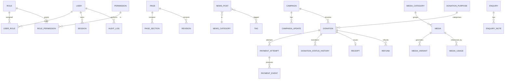

# Database Design — Shri Vanshidhar Gaushala

**Document status:** Phase 1 deliverable — decision pending approval (**D-03**)
**Version:** 1.0 (proposal)
**Last updated:** 2026-11-05
**Related:** `ARCHITECTURE.md` (ADR-003, ADR-004, ADR-007), `API_DESIGN.md`, `SECURITY_PLAN.md`

> **No database has been created.** This document records the recommended engine, the reasoning, the entity design and the constraints *before* implementation, as required by the project brief.

---

## Table of contents

1. [Database decision: PostgreSQL vs MongoDB](#1-database-decision-postgresql-vs-mongodb)
2. [Cross-cutting conventions](#2-cross-cutting-conventions)
3. [Entity-relationship overview](#3-entity-relationship-overview)
4. [Identity and access entities](#4-identity-and-access-entities)
5. [Content entities](#5-content-entities)
6. [Media entities](#6-media-entities)
7. [Enquiry entities](#7-enquiry-entities)
8. [Donation and payment entities](#8-donation-and-payment-entities)
9. [Platform entities](#9-platform-entities)
10. [Constraints that encode business rules](#10-constraints-that-encode-business-rules)
11. [Index strategy](#11-index-strategy)
12. [Migration strategy](#12-migration-strategy)
13. [Seeding and fixtures](#13-seeding-and-fixtures)
14. [Retention, archival and backups](#14-retention-archival-and-backups)
15. [Open questions](#15-open-questions)

---

## 1. Database decision: PostgreSQL vs MongoDB

### 1.1 The recommendation

> **PostgreSQL 16+ (single engine, no second database).**
> Approved Prisma ORM; JSONB for flexible CMS payloads; a small number of hand-written SQL migrations for constraints, partial indexes, triggers and report views.

### 1.2 What the workload actually looks like

Before comparing engines, it is worth being precise about the data this project stores. The blueprint implies nine distinct data families:

| Family | Shape | Consistency need |
|---|---|---|
| Users, roles, permissions | Many-to-many graph | Strong — a permission error is a security incident |
| Content (pages, news, events, campaigns, activities) | Records with relations to media, authors, categories, revisions | Strong — referential, revision history must be exact |
| Homepage builder | Ordered heterogeneous blocks | Medium — schema-flexible, order-sensitive |
| Media and usage tracking | Records plus a many-to-many usage graph | Strong — "in use" must never be wrong |
| Donations, payments, receipts, refunds | Financial ledger-style records with strict state transitions | **Very strong** — money |
| Enquiries | Append-mostly personal data | Medium |
| Audit log | Append-only event stream | Medium, but immutable |
| Settings | Small typed key/value groups | Strong — read on nearly every request |
| SEO (redirects, metadata, sitemap feed) | Small relational records with unique path constraints | Strong |

Two of these — permissions and money — dominate the decision. Nine of the ten families are relational at the core; exactly one (homepage blocks) benefits from schema flexibility.

### 1.3 Requirements the engine must satisfy

Derived from the blueprint, not from preference:

1. **R1 — Financial invariants at the storage layer.** "Enforce database constraints for financial and relational invariants" (blueprint §10). Amounts must be exact, positive, and impossible to persist in an inconsistent state.
2. **R2 — Multi-record atomic transitions.** A payment status change must atomically update the donation, append a history row, insert a deduplicated provider event and (on success) reserve a receipt number. Partial application is unacceptable.
3. **R3 — Uniqueness under concurrency.** Donation references, receipt numbers, idempotency keys, provider event IDs, slugs and redirect paths must be unique *even when two requests race*.
4. **R4 — Relational integrity with controlled deletion.** Media referenced by published content cannot vanish; campaigns referenced by donations cannot be deleted; roles in use cannot be dropped.
5. **R5 — Reporting correctness.** "Donation totals by verified status and date range", campaign progress, dashboard summaries. Must remain correct while writes happen.
6. **R6 — Schema flexibility for CMS blocks** without a migration per new block type.
7. **R7 — Revision history** with exact restore of past states.
8. **R8 — Auditable, queryable history** with time-range filters.
9. **R9 — Full-text search** over news and pages (optional but likely; internal search is mentioned in the blueprint).
10. **R10 — Operational maturity**: mature managed hosting in India, well-understood backup/PITR, a large hiring pool.

### 1.4 Comparison

Scores are relative: ✔✔ strong, ✔ adequate, ~ workable with extra effort, ✘ weak.

| Requirement | PostgreSQL | MongoDB | Comment |
|---|---|---|---|
| R1 financial invariants | ✔✔ `NUMERIC`/`BIGINT`, `CHECK`, `NOT NULL`, FK | ~ `$jsonSchema` validators are per-collection and weaker than typed columns; cross-field and cross-document rules are application-enforced | A `CHECK (amount_minor > 0)` cannot be bypassed by a buggy code path; a validator can be bypassed by writes that ignore validation (`bypassDocumentValidation`) |
| R2 atomic multi-record transitions | ✔✔ ACID across tables, explicit isolation levels, `SELECT … FOR UPDATE` | ✔ multi-document transactions exist (4.0+) but require replica sets, are bounded by a 60 s default limit and are materially more expensive | We need 4–6 documents updated together on every payment event |
| R3 uniqueness under concurrency | ✔✔ unique indexes across whole tables, partial unique indexes | ✔✔ unique indexes per collection | Parity |
| R4 relational integrity + delete rules | ✔✔ foreign keys with `RESTRICT`/`CASCADE` | ✘ no foreign keys; integrity lives in application code, which drifts | "Media in use must not break pages" is a `RESTRICT` in PostgreSQL and an audit script in MongoDB |
| R5 reporting correctness | ✔✔ joins, aggregates, window functions, materialised views | ~ aggregation pipeline works; joins are `$lookup`, which is slower and less optimisable | Donation reports join donation × campaign × purpose × receipt |
| R6 flexible CMS blocks | ✔✔ `JSONB` + GIN indexes | ✔✔ native | This is MongoDB's home turf — but JSONB closes the gap almost completely |
| R7 revision history | ✔✔ snapshot table with FK and version uniqueness | ✔ snapshot documents | Parity |
| R8 auditable history | ✔✔ with declarative partitioning on `created_at` | ✔ capped/TTL collections | Parity, PostgreSQL is easier to query alongside relational targets |
| R9 full-text search | ✔✔ `tsvector` + GIN, or `pg_trgm` for fuzzy | ✔✔ text indexes | MongoDB's built-in text search is decent; PostgreSQL is adequate for a content site of this size and avoids adding a search service |
| R10 operational maturity | ✔✔ managed options in `ap-south-1` from every major provider | ✔✔ Atlas has a Mumbai region | Parity |

### 1.5 The honest case for MongoDB

Presenting it fairly, because it influenced the analysis:

- **Schema flexibility is genuinely native.** A homepage builder where each block type has different fields maps naturally to documents. In MongoDB, adding a new block type requires no migration at all.
- **Denormalised reads are cheap.** A campaign page with its updates embedded is one document read. In PostgreSQL it is two queries or a join (both trivial at this scale).
- **Horizontal sharding** is built in, if the site ever needed very high write throughput across regions.
- **Rapid early iteration** — no migration files while the content model is still being discovered.
- **Aggregation pipeline** is expressive and pleasant for document-shaped analytics.

**Why these advantages do not win here:**

1. **The flexibility advantage is largely neutralised by JSONB.** PostgreSQL stores exactly the same JSON documents in a `jsonb` column, indexable with GIN, queryable with `->`/`@>`, and validated by Zod in the service layer. We get the flexibility *and* keep typed columns for the things that must be indexed and constrained (slug, status, dates, amounts, foreign keys). We do not have to choose.
2. **The flexibility argument is mostly about the CMS — a minority of the data.** Applying a document model to the *whole* schema to serve the homepage builder would optimise 15% of the workload at the cost of the 30% that must be strict.
3. **The cost of an integrity bug is asymmetric.** A duplicate donation record, a double-issued receipt, a status transition that half-applied, or an orphaned media reference on a live page are all user-visible trust failures for a charity asking for money. Foreign keys and `CHECK` constraints make entire classes of these bugs impossible rather than merely unlikely.
4. **Reporting will be asked for.** A donation manager will ask "how much did we verify this month, per campaign, minus refunds?" That question is a five-line SQL query across four tables, or a substantial aggregation pipeline with `$lookup` in MongoDB.
5. **Operational simplicity.** One database engine to back up, monitor, secure, restore and pay for. The blueprint explicitly warns against adding a second database without a compelling requirement; choosing a document store *because* it is document-shaped would be the same mistake in a different direction.
6. **Joins are replaced by application-level lookups in MongoDB,** which means N+1 queries or manual denormalisation. At CMS scale either is fine, but both create the drift that the blueprint's maintainability goal is trying to avoid.

### 1.6 Decision record

| Field | Value |
|---|---|
| **Decision** | PostgreSQL 16+ as the sole database |
| **Status** | Proposed — **⏳ APPROVAL REQUIRED (D-03)** |
| **Alternatives considered** | MongoDB; MySQL/MariaDB; SQLite; PostgreSQL + a separate document store |
| **Why MySQL was rejected** | Weaker JSONB-equivalent (`JSON` type lacks the indexable binary form and GIN), weaker partial-index and `RETURNING` support, weaker full-text search |
| **Why SQLite was rejected** | Single-writer limitation and no managed concurrent hosting; unsuitable for a donation site with a background worker |
| **Why PostgreSQL + MongoDB was rejected** | Two engines, two backup regimes, two consistency models, no requirement that needs it |
| **Reversibility** | **Low.** Reversing after donation data exists is a rewrite, not a migration |
| **Review date** | Revisit only if sustained write throughput exceeds ~2,000 writes/s or a genuine polyglot requirement appears |

### 1.7 Known PostgreSQL trade-offs (accepted)

| Trade-off | Mitigation |
|---|---|
| Every schema change needs a migration | Migrations are reviewed, versioned and reversible; expand-migrate-contract keeps deploys safe |
| Prisma cannot express partial indexes, some `CHECK`s, triggers | Hand-written SQL migrations, clearly commented, in `prisma/migrations/` |
| JSONB queries are less ergonomic than MongoDB's pipeline | Block payloads are read whole and rendered; we rarely query into them. Zod validates on write |
| Full-text search is less capable than a dedicated engine | `tsvector` + `pg_trgm` covers internal search; a search service can be added later behind the same interface |
| Row-level locking must be deliberate | All financial transitions use `SELECT … FOR UPDATE` inside a transaction — enforced by a service-layer test |
| No built-in sharding | Not needed at this scale; read replicas and caching are the first answers |

---

## 2. Cross-cutting conventions

### 2.1 Identifiers

| Convention | Value |
|---|---|
| Primary keys | `uuid` (UUIDv7, generated in application code for time-ordered index locality) |
| Public-facing keys | Slugs for content; a human-readable `reference` for donations |
| Foreign keys | `<entity>_id` `uuid` |
| Join tables | `<left>_<right>` with a composite primary key |

UUIDv7 is chosen over UUIDv4 because it is time-ordered: new rows append to the end of the B-tree instead of scattering across pages, which measurably improves write and range-scan performance on large tables such as `audit_log` and `donation_status_history`.

### 2.2 Naming

- `snake_case` for every table and column; plural table names.
- `created_at`, `updated_at`, `deleted_at` on every mutable entity.
- Boolean columns read as assertions: `is_published`, `is_featured`, `is_visible`.
- Enum types are PostgreSQL native enums, named `<table>_<column>_enum` (Prisma convention).
- Money columns end in `_minor` and are `BIGINT` (ADR-007).
- Timestamps are `timestamptz` (UTC storage). A separate `timezone` text column exists only where a wall-clock time must be preserved (events).

### 2.3 Standard columns

Every mutable entity carries:

```sql
id          uuid         PRIMARY KEY,
created_at  timestamptz  NOT NULL DEFAULT now(),
updated_at  timestamptz  NOT NULL DEFAULT now(),
created_by  uuid         NULL REFERENCES users(id) ON DELETE SET NULL,
updated_by  uuid         NULL REFERENCES users(id) ON DELETE SET NULL
```

Publishing-capable entities additionally carry:

```sql
status                   <enum>       NOT NULL DEFAULT 'DRAFT',
published_at             timestamptz  NULL,
scheduled_for            timestamptz  NULL,
unpublished_at           timestamptz  NULL,
current_revision_id      uuid         NULL REFERENCES revisions(id) ON DELETE SET NULL,
version                  integer      NOT NULL DEFAULT 1,   -- optimistic concurrency
deleted_at               timestamptz  NULL
```

SEO-capable entities additionally carry:

```sql
seo_title             varchar(70)   NULL,
seo_description       varchar(180)  NULL,
canonical_url         text          NULL,
og_image_id           uuid          NULL REFERENCES media(id) ON DELETE SET NULL,
noindex               boolean       NOT NULL DEFAULT false,
structured_data       jsonb         NULL   -- validated whitelist, never raw script
```

### 2.4 Soft delete

- Content, media, enquiries and users use `deleted_at` (soft delete) so history and audit references survive.
- Financial records (`donations`, `payment_attempts`, `payment_events`, `receipts`, `refunds`) are **never** deleted by the application; they are voided or reversed.
- The API filters `deleted_at IS NULL` by default; admin endpoints can request deleted rows with `?includeDeleted=true`.

### 2.5 Optimistic concurrency

`version integer NOT NULL DEFAULT 1` on every editable entity. Updates use:

```sql
UPDATE pages SET ..., version = version + 1
WHERE id = $1 AND version = $2 AND deleted_at IS NULL
RETURNING *;
```

Zero rows affected → `409 Conflict` with the current version and a diff hint. This prevents two staff members silently overwriting each other's edits.

### 2.6 Enum strategy

Native PostgreSQL enums for values that are part of the domain contract and change rarely (`donation_status`, `content_status`, `payment_event_type`). Adding a value is a migration (`ALTER TYPE … ADD VALUE`), which is deliberate: a new payment status should be reviewed, not invented at runtime.

---

## 3. Entity-relationship overview

### 3.1 Domain map



### 3.2 Table inventory (44 tables)

| Group | Tables |
|---|---|
| Identity & access (11) | `users`, `roles`, `permissions`, `role_permissions`, `user_roles`, `user_permissions`, `sessions`, `invitations`, `password_reset_tokens`, `user_mfa`, `mfa_recovery_codes` |
| Content (14) | `pages`, `page_sections`, `activities`, `news_posts`, `news_categories`, `tags`, `news_post_tags`, `events`, `campaigns`, `campaign_updates`, `impact_stats`, `testimonials`, `menu_items`, `revisions` |
| Media (4) | `media`, `media_categories`, `media_variants`, `media_usages` |
| Enquiries (2) | `enquiries`, `enquiry_notes` |
| Donations & payments (8) | `donation_purposes`, `donations`, `payment_attempts`, `payment_events`, `donation_status_history`, `receipts`, `refunds`, `idempotency_keys` |
| Platform (5) | `settings`, `redirects`, `audit_log`, `login_attempts`, `job_runs` |

> `revisions` is shared by all content types via `(entity_type, entity_id)`.

---

## 4. Identity and access entities

### 4.1 `users`

| Column | Type | Constraints | Notes |
|---|---|---|---|
| `id` | uuid | PK | UUIDv7 |
| `email` | citext | NOT NULL, UNIQUE | Case-insensitive; citext extension |
| `email_verified_at` | timestamptz | NULL | |
| `name` | varchar(120) | NOT NULL | |
| `password_hash` | text | NULL | NULL until invitation accepted |
| `password_updated_at` | timestamptz | NULL | |
| `must_change_password` | boolean | NOT NULL DEFAULT false | Set after admin reset |
| `status` | enum `user_status` | NOT NULL DEFAULT 'INVITED' | `INVITED, ACTIVE, SUSPENDED, DISABLED` |
| `is_super_admin` | boolean | NOT NULL DEFAULT false | Bypasses permission resolution; guarded |
| `mfa_required` | boolean | NOT NULL DEFAULT false | |
| `failed_login_count` | integer | NOT NULL DEFAULT 0 | Reset on success |
| `locked_until` | timestamptz | NULL | Progressive lockout |
| `last_login_at` | timestamptz | NULL | |
| `last_login_ip_hash` | text | NULL | Hashed, never raw IP (privacy) |
| `created_at` / `updated_at` | timestamptz | NOT NULL | |
| `deleted_at` | timestamptz | NULL | Soft delete |

**Constraints**
- `UNIQUE (email)` — one account per address.
- `CHECK (status <> 'ACTIVE' OR password_hash IS NOT NULL)` — an active account always has a password.
- Partial index `WHERE deleted_at IS NULL AND status = 'ACTIVE'`.
- Business rule (service + test): at least one `is_super_admin = true` account with `status = 'ACTIVE'` must exist.

### 4.2 `roles`

| Column | Type | Constraints | Notes |
|---|---|---|---|
| `id` | uuid | PK | |
| `key` | varchar(64) | NOT NULL, UNIQUE | `super_admin`, `content_editor`, `donation_manager`, `volunteer_manager` |
| `name` | varchar(120) | NOT NULL | Display name |
| `description` | text | NULL | |
| `is_system` | boolean | NOT NULL DEFAULT false | System templates cannot be deleted |
| `created_at` / `updated_at` | timestamptz | | |

### 4.3 `permissions`

| Column | Type | Constraints | Notes |
|---|---|---|---|
| `id` | uuid | PK | |
| `key` | varchar(80) | NOT NULL, UNIQUE | `donation.refund` |
| `resource` | varchar(40) | NOT NULL | `donation` |
| `action` | varchar(40) | NOT NULL | `refund` |
| `description` | text | NULL | Shown in the role editor |

Seed is generated from `packages/shared/src/permissions.ts`; a CI test asserts the database and the code catalogue are identical (no orphan permissions, no missing rows).

### 4.4 `role_permissions`

`(role_id uuid REFERENCES roles ON DELETE CASCADE, permission_id uuid REFERENCES permissions ON DELETE CASCADE, PRIMARY KEY (role_id, permission_id))`

### 4.5 `user_roles`

`(user_id, role_id, assigned_by uuid, assigned_at timestamptz, PRIMARY KEY (user_id, role_id))`

### 4.6 `user_permissions` (overrides)

| Column | Type | Constraints |
|---|---|---|
| `user_id` | uuid | FK `users` ON DELETE CASCADE |
| `permission_id` | uuid | FK `permissions` ON DELETE CASCADE |
| `effect` | enum `permission_effect` | `GRANT` / `DENY` |
| `reason` | text | NOT NULL — justification is mandatory |
| `granted_by` / `granted_at` | uuid / timestamptz | NOT NULL |
| PK | `(user_id, permission_id)` | |

Resolution order: role union → apply `GRANT` overrides → apply `DENY` overrides (deny always wins). Every override write is audited.

### 4.7 `sessions`

| Column | Type | Constraints | Notes |
|---|---|---|---|
| `id` | uuid | PK | |
| `user_id` | uuid | FK `users` ON DELETE CASCADE | |
| `token_hash` | char(64) | NOT NULL, UNIQUE | SHA-256 of the raw token; raw token never stored |
| `csrf_token_hash` | char(64) | NOT NULL | |
| `ip_hash` | char(64) | NULL | Hashed |
| `user_agent` | text | NULL | Truncated to 400 chars |
| `created_at` | timestamptz | NOT NULL | |
| `last_used_at` | timestamptz | NOT NULL | Sliding window |
| `expires_at` | timestamptz | NOT NULL | Absolute cap |
| `revoked_at` | timestamptz | NULL | |
| `revoked_reason` | varchar(80) | NULL | `logout`, `password_change`, `admin`, `mfa_reset` |

Indexes: `(user_id, revoked_at)`, `(expires_at)` for pruning.

### 4.8 `invitations`

`(id, email citext, role_ids uuid[], token_hash char(64) UNIQUE, invited_by uuid, expires_at timestamptz, accepted_at timestamptz NULL, created_at)` — single use, 72-hour expiry.

### 4.9 `password_reset_tokens`

`(id, user_id, token_hash char(64) UNIQUE, expires_at, used_at NULL, requested_ip_hash, created_at)` — 30-minute expiry, single use, all outstanding tokens invalidated on use.

### 4.10 `user_mfa`

| Column | Type | Notes |
|---|---|---|
| `user_id` | uuid PK | FK `users` ON DELETE CASCADE |
| `secret_encrypted` | bytea | AES-256-GCM, key from environment |
| `enabled_at` | timestamptz | NULL until first successful verification |
| `last_used_step` | bigint | Replay protection for the current TOTP window |

### 4.11 `mfa_recovery_codes`

`(id, user_id, code_hash char(64), used_at NULL, created_at)` — 10 codes, single use each.

---

## 5. Content entities

### 5.1 `pages`

Serves static pages **and** the homepage (`kind = 'HOMEPAGE'`) so publishing, revisions, SEO and preview logic exist once.

| Column | Type | Constraints | Notes |
|---|---|---|---|
| `id` | uuid | PK | |
| `kind` | enum `page_kind` | NOT NULL DEFAULT 'STANDARD' | `STANDARD`, `HOMEPAGE`, `POLICY` |
| `slug` | varchar(160) | NOT NULL | Unique among published, non-deleted rows |
| `title` | varchar(200) | NOT NULL | |
| `summary` | text | NULL | |
| `body` | jsonb | NULL | Rich-text document (editor JSON), not HTML |
| `template` | enum `page_template` | NOT NULL DEFAULT 'GENERIC' | Controls layout; CMS-selectable |
| `hero_media_id` | uuid | FK `media` ON DELETE SET NULL | |
| `hero_alt` | varchar(300) | NULL | Required when `hero_media_id` is set (service rule) |
| `status` | enum `content_status` | NOT NULL DEFAULT 'DRAFT' | |
| `published_at`, `scheduled_for`, `unpublished_at` | timestamptz | NULL | |
| `current_revision_id` | uuid | FK `revisions` ON DELETE SET NULL | |
| `version` | integer | NOT NULL DEFAULT 1 | |
| `seo_*`, `canonical_url`, `og_image_id`, `noindex`, `structured_data` | — | See §2.3 | |
| audit + soft delete | — | | |

**Constraints and indexes**
- `CREATE UNIQUE INDEX pages_slug_live_uniq ON pages (lower(slug)) WHERE deleted_at IS NULL;` — one live page per slug (drafts and published share the slug space so a redirect can never be ambiguous).
- `CHECK (kind <> 'HOMEPAGE' OR slug = '')` — the homepage owns the empty slug (served at `/`). *(Alternative: a dedicated singleton row with `slug = 'home'` and a route mapping. Decision recorded in §15.)*
- `CHECK (status <> 'PUBLISHED' OR published_at IS NOT NULL)`
- `CHECK (status <> 'SCHEDULED' OR scheduled_for IS NOT NULL)`
- `CREATE UNIQUE INDEX pages_single_homepage ON pages (kind) WHERE kind = 'HOMEPAGE' AND deleted_at IS NULL;`
- Index on `(status, scheduled_for)` for the publish worker.

### 5.2 `page_sections`

| Column | Type | Constraints |
|---|---|---|
| `id` | uuid | PK |
| `page_id` | uuid | FK `pages` ON DELETE CASCADE |
| `type` | varchar(40) | NOT NULL — `hero`, `trust_strip`, `about_preview`, `what_we_do`, `impact`, `featured_campaign`, `latest_news`, `latest_events`, `gallery_preview`, `support_cta`, `contact_block`, `rich_text` |
| `schema_version` | integer | NOT NULL DEFAULT 1 |
| `sort_order` | integer | NOT NULL |
| `is_visible` | boolean | NOT NULL DEFAULT true |
| `content` | jsonb | NOT NULL DEFAULT '{}' — Zod-validated per `type` |
| `created_at` / `updated_at` | timestamptz | |

**Constraints**
- `UNIQUE (page_id, sort_order)` — deterministic ordering, no ties.
- `CHECK (jsonb_typeof(content) = 'object')`.
- Service rule: `content` is validated against the block registry for `(type, schema_version)`; unknown types cannot be saved.

### 5.3 `revisions`

| Column | Type | Constraints | Notes |
|---|---|---|---|
| `id` | uuid | PK | |
| `entity_type` | enum `revision_entity` | NOT NULL | `PAGE`, `ACTIVITY`, `NEWS`, `EVENT`, `CAMPAIGN`, `IMPACT`, `TESTIMONIAL`, `SETTING` |
| `entity_id` | uuid | NOT NULL | Polymorphic; no FK (documented trade-off) |
| `version` | integer | NOT NULL | Monotonic per entity |
| `status` | enum `revision_status` | NOT NULL | `DRAFT`, `PUBLISHED`, `SUPERSEDED` |
| `snapshot` | jsonb | NOT NULL | Full entity + children at that moment |
| `change_note` | varchar(300) | NULL | |
| `created_by` | uuid | FK `users` ON DELETE SET NULL | |
| `created_at` | timestamptz | NOT NULL | |
| `published_at` | timestamptz | NULL | |

**Constraints**
- `UNIQUE (entity_type, entity_id, version)`.
- `CREATE UNIQUE INDEX revisions_one_published ON revisions (entity_type, entity_id) WHERE status = 'PUBLISHED';` — at most one live revision per entity.
- `snapshot` is immutable after insert: a `BEFORE UPDATE` trigger raises an exception if `snapshot` changes.
- Index `(entity_type, entity_id, created_at DESC)` for the history list.

**Polymorphic trade-off:** a generic revision table loses the foreign key to each entity. Accepted because (a) revisions are read only through their entity, (b) a nightly integrity job reports orphaned revisions, and (c) seven near-identical tables would be materially worse for maintenance.

### 5.4 `activities`

| Column | Type | Constraints |
|---|---|---|
| `id` | uuid | PK |
| `title` | varchar(200) | NOT NULL |
| `slug` | varchar(160) | NOT NULL, unique live |
| `short_description` | varchar(400) | NOT NULL |
| `body` | jsonb | NULL |
| `category` | varchar(60) | NULL (CMS-managed list) |
| `media_id` | uuid | FK `media` ON DELETE SET NULL |
| `media_alt` | varchar(300) | NULL |
| `activity_date` | date | NULL |
| `location` | varchar(200) | NULL |
| `is_featured` | boolean | NOT NULL DEFAULT false |
| status / version / SEO / audit | — | As §2.3 |

### 5.5 `news_categories`

`(id uuid PK, name varchar(80) NOT NULL, slug varchar(80) NOT NULL UNIQUE, description text, sort_order integer, created_at, updated_at)`

### 5.6 `news_posts`

| Column | Type | Constraints |
|---|---|---|
| `id` | uuid | PK |
| `title` | varchar(200) | NOT NULL |
| `slug` | varchar(160) | NOT NULL, unique live |
| `excerpt` | varchar(400) | NOT NULL |
| `body` | jsonb | NOT NULL |
| `cover_media_id` | uuid | FK `media` ON DELETE SET NULL |
| `cover_alt` | varchar(300) | NULL |
| `category_id` | uuid | FK `news_categories` ON DELETE SET NULL |
| `author_user_id` | uuid | FK `users` ON DELETE SET NULL |
| `attribution_name` | varchar(120) | NULL — organisation attribution when no individual author |
| `reading_minutes` | integer | NULL — derived on save |
| `published_at` / `updated_display_at` | timestamptz | `updated_display_at` only changes on a substantive edit (blueprint: do not change dates merely to appear fresh) |
| status / version / SEO / audit | — | |

Indexes: `(status, published_at DESC)`, `(category_id, status)`, GIN on `to_tsvector('english', title || ' ' || excerpt)`.

### 5.7 `tags` and `news_post_tags`

`tags (id, name varchar(60) UNIQUE, slug varchar(60) UNIQUE)`
`news_post_tags (news_post_id, tag_id, PRIMARY KEY (news_post_id, tag_id))`

### 5.8 `events`

| Column | Type | Constraints | Notes |
|---|---|---|---|
| `id` | uuid | PK | |
| `title` | varchar(200) | NOT NULL | |
| `slug` | varchar(160) | NOT NULL unique live | |
| `description` | jsonb | NOT NULL | |
| `start_at` | timestamptz | NOT NULL | |
| `end_at` | timestamptz | NULL | |
| `timezone` | varchar(64) | NOT NULL DEFAULT 'Asia/Kolkata' | IANA name; explicit per blueprint |
| `venue_name` | varchar(200) | NULL | |
| `venue_address` | text | NULL | |
| `venue_map_url` | text | NULL | |
| `is_online` | boolean | NOT NULL DEFAULT false | |
| `poster_media_id` | uuid | FK `media` | |
| `event_status` | enum `event_status` | NOT NULL DEFAULT 'SCHEDULED' | `SCHEDULED, COMPLETED, CANCELLED, POSTPONED` — distinct from publishing `status` |
| `is_featured` | boolean | NOT NULL DEFAULT false | |
| `registration_mode` | enum | NOT NULL DEFAULT 'NONE' | `NONE, CONTACT, EXTERNAL_URL, ENQUIRY_FORM` |
| `registration_url` | text | NULL | |
| `capacity` | integer | NULL, `CHECK (capacity IS NULL OR capacity > 0)` | |
| status / version / SEO / audit | — | | |

**Constraints**
- `CHECK (end_at IS NULL OR end_at >= start_at)`.
- `CHECK (registration_mode <> 'EXTERNAL_URL' OR registration_url IS NOT NULL)`.
- Index `(event_status, start_at)`, `(status, start_at)`.

### 5.9 `campaigns`

| Column | Type | Constraints | Notes |
|---|---|---|---|
| `id` | uuid | PK | |
| `name` | varchar(200) | NOT NULL | |
| `slug` | varchar(160) | NOT NULL unique live | |
| `purpose_summary` | varchar(400) | NOT NULL | |
| `story` | jsonb | NOT NULL | |
| `target_amount_minor` | bigint | NULL, `CHECK (> 0)` | Optional: a campaign may not have a financial goal |
| `currency` | char(3) | NOT NULL DEFAULT 'INR' | |
| `start_date` | date | NOT NULL | |
| `end_date` | date | NULL, `CHECK (end_date IS NULL OR end_date >= start_date)` | |
| `progress_source` | enum `progress_source` | NOT NULL DEFAULT 'VERIFIED_DONATIONS' | `VERIFIED_DONATIONS, MANUAL` |
| `manual_raised_minor` | bigint | NULL, `CHECK (>= 0)` | Only when `progress_source = 'MANUAL'`; audited |
| `manual_raised_note` | text | NULL | Required when manual |
| `use_of_funds` | jsonb | NULL | |
| `faqs` | jsonb | NULL | |
| `cover_media_id` | uuid | FK `media` | |
| `donation_purpose_id` | uuid | FK `donation_purposes` ON DELETE SET NULL | |
| `is_featured` | boolean | NOT NULL DEFAULT false | |
| `accepts_donations` | boolean | NOT NULL DEFAULT true | |
| status / version / SEO / audit | — | | |

**Constraints**
- `CHECK (progress_source <> 'MANUAL' OR (manual_raised_minor IS NOT NULL AND manual_raised_note IS NOT NULL))` — a manual total cannot exist without a stated source.
- `CHECK (target_amount_minor IS NULL OR manual_raised_minor IS NULL OR manual_raised_minor <= target_amount_minor * 10)` — loose sanity guard against typos.
- `CREATE UNIQUE INDEX campaigns_one_featured ON campaigns (is_featured) WHERE is_featured AND deleted_at IS NULL;` — the homepage features exactly one campaign.

### 5.10 `campaign_updates`

`(id, campaign_id FK ON DELETE CASCADE, title varchar(200), body jsonb, media_id FK media, published_at timestamptz, status content_status, created_by, created_at, updated_at)`
Index `(campaign_id, published_at DESC)`.

### 5.11 `impact_stats`

| Column | Type | Constraints | Notes |
|---|---|---|---|
| `id` | uuid | PK | |
| `label` | varchar(120) | NOT NULL | |
| `value` | numeric(18,2) | NOT NULL | Supports non-integers where meaningful |
| `unit` | varchar(40) | NULL | `cattle`, `meals`, `litres`, `years` |
| `period_start` / `period_end` | date | NULL | Reporting period |
| `period_label` | varchar(80) | NULL | Display form, e.g. "FY 2025–26" |
| `methodology` | text | NOT NULL | Required by the blueprint |
| `source_note` | varchar(300) | NULL | |
| `display_order` | integer | NOT NULL | |
| `is_visible` | boolean | NOT NULL DEFAULT true | |
| `verification_status` | enum | NOT NULL DEFAULT 'DRAFT' | `DRAFT, VERIFIED` |
| `verified_by` | uuid | FK `users` | |
| `verified_at` | timestamptz | NULL | |

**Constraint (the truthfulness gate, in the database):**
```sql
ALTER TABLE impact_stats ADD CONSTRAINT impact_verified_requires_evidence
  CHECK (verification_status <> 'VERIFIED'
         OR (verified_by IS NOT NULL AND verified_at IS NOT NULL AND length(methodology) > 0));
```
Public API predicate: `verification_status = 'VERIFIED' AND is_visible AND deleted_at IS NULL`.

### 5.12 `testimonials`

`(id, body text NOT NULL, display_name varchar(120) NOT NULL, location varchar(120), consent_evidence varchar(300) NOT NULL, consent_date date NOT NULL, approval_status enum ('PENDING','APPROVED','REJECTED') DEFAULT 'PENDING', approved_by uuid, approved_at timestamptz, media_id uuid, is_visible boolean, display_order integer, created_at, updated_at, deleted_at)`

Constraint: `APPROVED` requires `approved_by`, `approved_at` and non-empty `consent_evidence`.

### 5.13 `menu_items`

| Column | Type | Constraints |
|---|---|---|
| `id` | uuid | PK |
| `menu_key` | enum `menu_key` | NOT NULL — `HEADER`, `FOOTER_PRIMARY`, `FOOTER_LEGAL`, `FOOTER_SOCIAL` |
| `label` | varchar(80) | NOT NULL |
| `href` | varchar(300) | NOT NULL |
| `parent_id` | uuid | FK self, ON DELETE CASCADE, max depth 2 (service rule) |
| `sort_order` | integer | NOT NULL |
| `is_visible` | boolean | NOT NULL DEFAULT true |
| `open_in_new_tab` | boolean | NOT NULL DEFAULT false |

Constraint `UNIQUE (menu_key, parent_id, sort_order)`; service validation that `href` is site-relative or `https://`.

---

## 6. Media entities

### 6.1 `media_categories`

`(id, name varchar(80), slug varchar(80) UNIQUE, kind enum ('GALLERY','DOCUMENT') DEFAULT 'GALLERY', description, sort_order, created_at, updated_at)`

### 6.2 `media`

| Column | Type | Constraints | Notes |
|---|---|---|---|
| `id` | uuid | PK | Stable across replacement |
| `storage_key` | varchar(500) | NOT NULL, UNIQUE | `2026/11/<uuid>.jpg` |
| `bucket` | varchar(80) | NOT NULL | `public` / `private` |
| `original_filename` | varchar(300) | NOT NULL | Display only, never used as a path |
| `mime_type` | varchar(100) | NOT NULL | Verified from bytes |
| `size_bytes` | bigint | NOT NULL, `CHECK (> 0)` | |
| `width` / `height` | integer | NULL | |
| `checksum_sha256` | char(64) | NOT NULL | Duplicate detection |
| `blurhash` | varchar(120) | NULL | Placeholder while loading |
| `focal_x` / `focal_y` | numeric(4,3) | NULL | Crop hint |
| `alt_text` | varchar(300) | NULL | Required when used in content |
| `caption` | varchar(400) | NULL | |
| `credit` | varchar(200) | NULL | |
| `category_id` | uuid | FK `media_categories` ON DELETE SET NULL | |
| `kind` | enum `media_kind` | NOT NULL | `IMAGE`, `VIDEO`, `DOCUMENT` |
| `is_public` | boolean | NOT NULL DEFAULT false | Controls bucket + serving |
| `status` | enum `media_status` | NOT NULL DEFAULT 'PROCESSING' | `PROCESSING, READY, FAILED` |
| `replaced_at` | timestamptz | NULL | Replacement keeps the ID |
| `uploaded_by` | uuid | FK `users` | |
| `captured_at` | date | NULL | Supplied by staff, not EXIF |
| `created_at` / `updated_at` / `deleted_at` | timestamptz | | |

Indexes: `(category_id, created_at DESC)`, `(checksum_sha256)`, `(status)`, GIN on `to_tsvector(original_filename || ' ' || coalesce(alt_text,''))`.

### 6.3 `media_variants`

`(id, media_id FK ON DELETE CASCADE, variant varchar(40), format varchar(10), width integer, height integer, storage_key varchar(500), size_bytes bigint, UNIQUE (media_id, variant, format))`

Variants: `thumb` 320, `card` 640, `hero` 1280, `full` 2000. Formats: `avif`, `webp`, `jpeg`.

### 6.4 `media_usages`

| Column | Type | Constraints |
|---|---|---|
| `id` | uuid | PK |
| `media_id` | uuid | FK `media` ON DELETE RESTRICT |
| `entity_type` | enum | `PAGE, PAGE_SECTION, ACTIVITY, NEWS, EVENT, CAMPAIGN, CAMPAIGN_UPDATE, IMPACT, TESTIMONIAL, SETTING` |
| `entity_id` | uuid | NOT NULL |
| `field_path` | varchar(120) | NOT NULL — e.g. `cover_media_id`, `sections[2].content.imageId` |
| `created_at` | timestamptz | |

`UNIQUE (media_id, entity_type, entity_id, field_path)`.
`ON DELETE RESTRICT` is the media in-use safeguard: the database refuses to delete a referenced image even if application logic is wrong.
Rows are rebuilt transactionally on every content write by the media module (delete-then-insert for that entity).

---

## 7. Enquiry entities

### 7.1 `enquiries`

| Column | Type | Constraints | Notes |
|---|---|---|---|
| `id` | uuid | PK | |
| `reference` | varchar(24) | NOT NULL, UNIQUE | e.g. `ENQ-2026-0001` |
| `type` | enum `enquiry_type` | NOT NULL | `CONTACT, VOLUNTEER, VISIT, EVENT_REGISTRATION, DONATION_SUPPORT, GENERAL` |
| `name` | varchar(120) | NOT NULL | |
| `email` | citext | NOT NULL | |
| `phone` | varchar(20) | NULL | |
| `subject` | varchar(200) | NULL | |
| `message` | text | NOT NULL, `CHECK (length(message) BETWEEN 10 AND 5000)` | |
| `event_id` | uuid | FK `events` ON DELETE SET NULL | For registrations |
| `consent_given_at` | timestamptz | NOT NULL | |
| `consent_version` | varchar(20) | NOT NULL | Which privacy notice version |
| `status` | enum `enquiry_status` | NOT NULL DEFAULT 'NEW' | `NEW, IN_PROGRESS, RESOLVED, SPAM, ARCHIVED` |
| `assigned_to` | uuid | FK `users` ON DELETE SET NULL | |
| `source_path` | varchar(300) | NULL | Which page the form was on |
| `ip_hash` | char(64) | NULL | Hashed |
| `user_agent` | text | NULL | |
| `spam_score` | numeric(4,2) | NULL | From the spam control |
| `retention_delete_at` | timestamptz | NULL | Scheduled purge |
| `created_at` / `updated_at` | timestamptz | | |

Indexes: `(status, created_at DESC)`, `(type, status)`, `(assigned_to, status)`, `(retention_delete_at) WHERE retention_delete_at IS NOT NULL`.

### 7.2 `enquiry_notes`

`(id, enquiry_id FK ON DELETE CASCADE, author_id uuid FK users ON DELETE SET NULL, body text NOT NULL, is_internal boolean DEFAULT true, created_at)`

---

## 8. Donation and payment entities

This is the most constrained part of the schema. Every rule here exists because money is involved.

### 8.1 `donation_purposes`

| Column | Type | Constraints | Notes |
|---|---|---|---|
| `id` | uuid | PK | |
| `code` | varchar(40) | NOT NULL, UNIQUE | `general`, `fodder`, `medical`, `shelter`, `<campaign-code>` |
| `label` | varchar(120) | NOT NULL | |
| `description` | varchar(400) | NULL | |
| `campaign_id` | uuid | FK `campaigns` ON DELETE SET NULL | Optional link |
| `is_active` | boolean | NOT NULL DEFAULT true | |
| `sort_order` | integer | NOT NULL | |
| `created_at` / `updated_at` | timestamptz | | |

### 8.2 `donations`

| Column | Type | Constraints | Notes |
|---|---|---|---|
| `id` | uuid | PK | |
| `reference` | varchar(32) | NOT NULL, UNIQUE | Human-readable, e.g. `SVG-DN-2026-000123`; sequence-backed |
| `status` | enum `donation_status` | NOT NULL DEFAULT 'PENDING' | |
| `amount_minor` | bigint | NOT NULL, `CHECK (amount_minor > 0)` | Paise |
| `currency` | char(3) | NOT NULL DEFAULT 'INR', `CHECK (currency = 'INR')` | Extendable later |
| `purpose_id` | uuid | FK `donation_purposes` ON DELETE SET NULL | |
| `campaign_id` | uuid | FK `campaigns` ON DELETE SET NULL | Denormalised for reporting; validated against purpose |
| `donor_name` | varchar(120) | NOT NULL | |
| `donor_email` | citext | NOT NULL | |
| `donor_phone` | varchar(20) | NULL | |
| `donor_pan_encrypted` | bytea | NULL | Only when a receipt requires it; AES-256-GCM |
| `donor_address` | text | NULL | Same rule |
| `is_anonymous` | boolean | NOT NULL DEFAULT false | Hides the name in public displays |
| `wants_receipt` | boolean | NOT NULL DEFAULT false | |
| `message` | varchar(1000) | NULL | Donor note |
| `consent_given_at` | timestamptz | NOT NULL | |
| `consent_version` | varchar(20) | NOT NULL | |
| `source_path` | varchar(300) | NULL | Attribution |
| `status_updated_at` | timestamptz | NOT NULL DEFAULT now() | |
| `verified_at` | timestamptz | NULL | Set only on verified success |
| `verified_via` | enum `verification_source` | NULL | `WEBHOOK`, `STATUS_CHECK`, `MANUAL_ADMIN` |
| `expires_at` | timestamptz | NULL | Pending expiry horizon |
| `created_at` / `updated_at` | timestamptz | | |

**Constraints**
- `CHECK (status <> 'SUCCEEDED' OR (verified_at IS NOT NULL AND verified_via IS NOT NULL))` — a donation cannot be marked successful without a recorded verification source. This is the database-level embodiment of "a browser redirect is not proof of payment".
- `CHECK (status NOT IN ('REFUNDED','PARTIALLY_REFUNDED') OR EXISTS (SELECT 1 FROM refunds r WHERE r.donation_id = id AND r.status = 'SUCCEEDED'))` — implemented as a deferred constraint trigger (a `CHECK` cannot reference another table).
- `CHECK (is_anonymous = false OR length(donor_name) > 0)`.
- Index `(status, created_at DESC)`, `(campaign_id, status)`, `(purpose_id, status)`, `(donor_email)`, `(expires_at) WHERE status IN ('PENDING','PROCESSING')`.
- **Reporting view** `donation_totals` (materialised or plain view) summing `amount_minor` grouped by campaign, purpose, status and month, used by the dashboard and campaign progress.

### 8.3 `payment_attempts`

One row per checkout attempt against a provider. A donation may have several (the donor retried).

| Column | Type | Constraints | Notes |
|---|---|---|---|
| `id` | uuid | PK | |
| `donation_id` | uuid | FK `donations` ON DELETE RESTRICT | |
| `provider` | varchar(40) | NOT NULL | `mock`, `idfc` |
| `provider_order_id` | varchar(120) | NULL | UNIQUE per provider when present |
| `provider_payment_id` | varchar(120) | NULL | UNIQUE per provider when present |
| `mode` | enum `payment_mode` | NOT NULL | `TEST`, `LIVE` |
| `amount_minor` | bigint | NOT NULL, `CHECK (> 0)` | Snapshot of the amount sent to the provider |
| `currency` | char(3) | NOT NULL | |
| `status` | enum `payment_attempt_status` | NOT NULL DEFAULT 'CREATED' | `CREATED, INITIATED, PENDING, SUCCEEDED, FAILED, CANCELLED, EXPIRED` |
| `idempotency_key` | varchar(120) | NOT NULL | |
| `redirect_url` | text | NULL | |
| `expires_at` | timestamptz | NULL | |
| `last_checked_at` | timestamptz | NULL | For reconciliation |
| `created_at` / `updated_at` | timestamptz | | |

**Constraints**
- `CREATE UNIQUE INDEX payment_attempts_provider_order_uniq ON payment_attempts (provider, provider_order_id) WHERE provider_order_id IS NOT NULL;`
- `CREATE UNIQUE INDEX payment_attempts_provider_payment_uniq ON payment_attempts (provider, provider_payment_id) WHERE provider_payment_id IS NOT NULL;` — the same provider transaction can never satisfy two donations.
- `CREATE UNIQUE INDEX payment_attempts_one_active ON payment_attempts (donation_id) WHERE status IN ('CREATED','INITIATED','PENDING');`
- `CHECK (mode <> 'LIVE' OR provider <> 'mock')` — mock can never record a live attempt.

### 8.4 `payment_events` (webhook inbox)

| Column | Type | Constraints | Notes |
|---|---|---|---|
| `id` | uuid | PK | |
| `provider` | varchar(40) | NOT NULL | |
| `provider_event_id` | varchar(160) | NOT NULL | |
| `attempt_id` | uuid | FK `payment_attempts` ON DELETE SET NULL | NULL when unmatched |
| `donation_id` | uuid | FK `donations` ON DELETE SET NULL | |
| `event_type` | enum `payment_event_type` | NOT NULL | |
| `signature_valid` | boolean | NOT NULL | |
| `payload_hash` | char(64) | NOT NULL | SHA-256 of the raw body — retained instead of the payload |
| `amount_minor` | bigint | NULL | Parsed for comparison |
| `currency` | char(3) | NULL | |
| `processing_status` | enum `event_processing_status` | NOT NULL | `RECEIVED, APPLIED, DUPLICATE, UNMATCHED, AMOUNT_MISMATCH, REJECTED, FAILED` |
| `processing_note` | varchar(400) | NULL | |
| `source_ip_hash` | char(64) | NULL | |
| `received_at` | timestamptz | NOT NULL DEFAULT now() | |
| `processed_at` | timestamptz | NULL | |

**Constraint:** `UNIQUE (provider, provider_event_id)` — the replay-protection primitive. A duplicate insert fails with a unique violation, which the handler interprets as "already processed" and returns `200`.

Index `(provider, processing_status, received_at)` for the operations view.

### 8.5 `donation_status_history`

`(id, donation_id FK ON DELETE RESTRICT, from_status donation_status NULL, to_status donation_status NOT NULL, actor_type enum ('SYSTEM','ADMIN','PROVIDER') NOT NULL, actor_id uuid NULL, reason varchar(400), payment_event_id uuid NULL, created_at timestamptz NOT NULL)`

Append-only: a trigger rejects `UPDATE` and `DELETE`. Index `(donation_id, created_at)`.

### 8.6 `receipts`

| Column | Type | Constraints | Notes |
|---|---|---|---|
| `id` | uuid | PK | |
| `donation_id` | uuid | FK `donations` ON DELETE RESTRICT | |
| `receipt_number` | varchar(40) | NOT NULL, UNIQUE | From a dedicated sequence, gapless within a financial year |
| `financial_year` | varchar(9) | NOT NULL | `2026-27` — numbering resets per year by policy |
| `sequence_no` | integer | NOT NULL | `UNIQUE (financial_year, sequence_no)` |
| `status` | enum `receipt_status` | NOT NULL DEFAULT 'ISSUED' | `ISSUED, SUPERSEDED, VOID` |
| `issued_at` | timestamptz | NOT NULL | |
| `issued_by` | uuid | FK `users` ON DELETE SET NULL | NULL when system-issued |
| `legal_snapshot` | jsonb | NOT NULL | Organisation name, address, registration/tax wording **as configured at issue time** |
| `amount_minor` | bigint | NOT NULL | Snapshot |
| `pdf_media_id` | uuid | FK `media` ON DELETE SET NULL | Private bucket |
| `voided_at` / `voided_by` / `void_reason` | — | NULL | Super Admin only |
| `created_at` | timestamptz | | |

**Constraints**
- `CREATE UNIQUE INDEX receipts_one_active_per_donation ON receipts (donation_id) WHERE status IN ('ISSUED','SUPERSEDED');` — one receipt lineage per donation; voiding allows reissue.
- Gapless numbering: `sequence_no` is allocated from `receipt_seq_<fy>` inside the issuing transaction. If the transaction rolls back, the number is released (the sequence is not `NO CYCLE`-advanced by failed inserts because allocation happens on insert within the same transaction).

### 8.7 `refunds`

| Column | Type | Constraints |
|---|---|---|
| `id` | uuid | PK |
| `donation_id` | uuid | FK `donations` ON DELETE RESTRICT |
| `amount_minor` | bigint | NOT NULL, `CHECK (> 0)` |
| `currency` | char(3) | NOT NULL |
| `status` | enum `refund_status` | NOT NULL DEFAULT 'PENDING' — `PENDING, SUCCEEDED, FAILED` |
| `reason` | varchar(400) | NOT NULL |
| `provider_refund_id` | varchar(120) | NULL, UNIQUE when present |
| `initiated_by` | uuid | FK `users` |
| `initiated_at` | timestamptz | NOT NULL |
| `processed_at` | timestamptz | NULL |

**Constraint:** a deferred trigger asserts `SUM(succeeded refunds) <= donation.amount_minor` — partial refunds cannot exceed the donation.

### 8.8 `idempotency_keys`

| Column | Type | Constraints |
|---|---|---|
| `key` | varchar(120) | NOT NULL |
| `scope` | varchar(60) | NOT NULL — route or operation name |
| `actor_key` | varchar(64) | NOT NULL — session-user hash or anonymous-cookie hash |
| `request_hash` | char(64) | NOT NULL |
| `response_status` | integer | NULL |
| `response_body` | jsonb | NULL |
| `created_at` | timestamptz | NOT NULL |
| `expires_at` | timestamptz | NOT NULL |
| PK | `(scope, actor_key, key)` | |

Index on `expires_at` for the pruning job.

---

## 9. Platform entities

### 9.1 `settings`

| Column | Type | Constraints | Notes |
|---|---|---|---|
| `key` | varchar(80) | PK | `site.general`, `contact.details`, `donation.presets`, `seo.defaults`, `forms.config`, `email.config` … |
| `category` | varchar(40) | NOT NULL | Groups the admin screen |
| `value` | jsonb | NOT NULL | Zod-validated on read *and* write |
| `description` | text | NULL | |
| `updated_by` | uuid | FK `users` ON DELETE SET NULL | |
| `created_at` / `updated_at` | timestamptz | | |

**No secrets in this table.** Provider credentials, SMTP passwords and signing keys live in environment variables. The only payment-related value stored here is a non-secret operational state (`providerMode`, `killSwitch`, `lastWebhookAt`).

### 9.2 `redirects`

`(id, from_path varchar(300) NOT NULL UNIQUE, to_path varchar(300) NOT NULL, status_code smallint NOT NULL DEFAULT 301 CHECK (status_code IN (301,302,307,308)), is_active boolean NOT NULL DEFAULT true, hits bigint NOT NULL DEFAULT 0, note varchar(200), created_by uuid, created_at, updated_at)`

Constraints: `CHECK (from_path <> to_path)`, `CHECK (from_path LIKE '/%')`, `CHECK (to_path LIKE '/%' OR to_path LIKE 'https://%')`. Chain detection runs on write (reject if `to_path` is itself a `from_path`, unless resolved to a final target).

### 9.3 `audit_log`

| Column | Type | Notes |
|---|---|---|
| `id` | uuid PK | |
| `actor_type` | enum | `USER, SYSTEM, PROVIDER` |
| `actor_user_id` | uuid | FK `users` ON DELETE SET NULL |
| `actor_label` | varchar(120) | Snapshot of the actor's name/email at the time |
| `action` | varchar(80) | `donation.status_changed`, `page.published`, `role.updated`, `user.suspended` |
| `entity_type` | varchar(60) | |
| `entity_id` | uuid | |
| `before` | jsonb | Sanitised subset — never secrets, never full payment payloads |
| `after` | jsonb | Sanitised subset |
| `metadata` | jsonb | Request ID, IP hash, filter criteria for exports |
| `created_at` | timestamptz NOT NULL DEFAULT now() | |

Append-only (trigger rejects `UPDATE`/`DELETE`). Partitioned by month on `created_at`; 24-month retention with an archival job.
Indexes: `(entity_type, entity_id, created_at DESC)`, `(actor_user_id, created_at DESC)`, `(action, created_at DESC)`.

### 9.4 `login_attempts`

`(id, email citext, ip_hash char(64), success boolean, failure_reason varchar(60), user_agent text, created_at)`
Retained 90 days for abuse analysis; used with Redis counters for lockout. Index `(email, created_at DESC)`, `(ip_hash, created_at DESC)`.

### 9.5 `job_runs`

`(id, job_name varchar(80), started_at, finished_at, status enum ('RUNNING','SUCCEEDED','FAILED'), items_processed integer, error text)`
The operational record for scheduled publishing, reconciliation, retention cleanup and media purge. The admin dashboard surfaces the last failure.

---

## 10. Constraints that encode business rules

These are the invariants that must hold even if a future code change forgets them.

| # | Rule | Enforced by |
|---|---|---|
| C1 | A donation is never `SUCCEEDED` without a verification source | `CHECK` on `donations` |
| C2 | The same provider transaction cannot satisfy two donations | Unique partial index on `payment_attempts` |
| C3 | A webhook event is processed at most once | `UNIQUE (provider, provider_event_id)` on `payment_events` |
| C4 | A donation has at most one receipt lineage | Unique partial index on `receipts` |
| C5 | Refunded totals never exceed the donation amount | Deferred constraint trigger |
| C6 | Only one active payment attempt per donation | Unique partial index |
| C7 | Mock provider cannot record live attempts | `CHECK` on `payment_attempts` |
| C8 | A slug has at most one live record | Unique partial index per content table |
| C9 | Only one homepage row | Unique partial index on `pages(kind)` |
| C10 | Only one featured campaign at a time | Unique partial index on `campaigns` |
| C11 | Content cannot be `PUBLISHED` without `published_at`; cannot be `SCHEDULED` without `scheduled_for` | `CHECK` |
| C12 | Exactly one `PUBLISHED` revision per entity | Unique partial index on `revisions` |
| C13 | Revisions and status history are immutable | `BEFORE UPDATE/DELETE` triggers |
| C14 | Impact statistics cannot be verified without evidence | `CHECK` on `impact_stats` |
| C15 | Testimonials cannot be approved without consent evidence | `CHECK` on `testimonials` |
| C16 | Referenced media cannot be deleted | `media_usages.media_id ON DELETE RESTRICT` |
| C17 | Donations and receipts cannot be deleted | `ON DELETE RESTRICT` from history/attempts/receipts |
| C18 | Section order within a page is unique and gap-free per write | `UNIQUE (page_id, sort_order)` + service reindex |
| C19 | A campaign manual-raised figure requires a stated source | `CHECK` on `campaigns` |
| C20 | Event end cannot precede start; registration URL required when needed | `CHECK` on `events` |
| C21 | Audit log and status history are append-only | Triggers + no application delete path |
| C22 | At least one active Super Admin exists | Service guard + integration test |
| C23 | Permissions in code and database stay in sync | CI test comparing the catalogue |

---

## 11. Index strategy

Principles: index every foreign key that is filtered or joined, every column used in a list `ORDER BY` with a filter, and every uniqueness rule. Avoid speculative indexes; add them from observed query patterns in Phase 11 load testing.

### 11.1 Minimum index set

| Table | Index | Reason |
|---|---|---|
| `users` | `(email) UNIQUE` | Login |
| `sessions` | `(token_hash) UNIQUE`, `(user_id, revoked_at)`, `(expires_at)` | Auth, session list, pruning |
| `role_permissions` | `(role_id)`, `(permission_id)` | Permission resolution |
| `user_roles` | `(user_id)` | Permission resolution |
| `pages` | `(status, scheduled_for)`, `(status, published_at DESC)`, unique live slug | Lists, worker, routing |
| `page_sections` | `(page_id, sort_order)` | Render |
| `news_posts` | `(status, published_at DESC)`, `(category_id, status)`, GIN `tsvector` | Lists, archive, search |
| `events` | `(status, start_at)`, `(event_status, start_at)` | Upcoming/past |
| `campaigns` | `(status, is_featured)`, unique featured | Homepage + lists |
| `media` | `(category_id, created_at DESC)`, `(checksum_sha256)`, `(status)` | Library, dedupe, cleanup |
| `media_usages` | `(media_id)`, `(entity_type, entity_id)` | In-use check, rebuild |
| `enquiries` | `(status, created_at DESC)`, `(assigned_to, status)`, `(retention_delete_at)` | Inbox, purge |
| `donations` | `(status, created_at DESC)`, `(campaign_id, status)`, `(purpose_id, status)`, `(donor_email)` | Reporting, search |
| `payment_attempts` | `(donation_id)`, unique provider IDs, unique active | Reconciliation |
| `payment_events` | `(provider, processing_status, received_at)`, unique event | Ops, replay |
| `receipts` | `(donation_id)`, unique number, `(financial_year, sequence_no)` | Issuance |
| `audit_log` | `(entity_type, entity_id, created_at DESC)`, `(actor_user_id, created_at DESC)`, `(action, created_at DESC)` | Investigation |
| `redirects` | `(from_path) UNIQUE`, `(is_active)` | Middleware lookup |

### 11.2 JSONB indexing

Only where queries need it: `page_sections (type)` and a GIN index on `page_sections.content` for block-level lookups (e.g. "which pages feature campaign X"). Block payloads are otherwise read whole.

### 11.3 Query-hygiene rules

- Every admin list endpoint has a covering index for its default sort.
- No unbounded `SELECT *` on `audit_log`, `login_attempts` or `payment_events` — these require a date range.
- Pagination is keyset-based on `(created_at, id)` for large tables.
- `EXPLAIN` review is part of Phase 11 for the five heaviest dashboard queries.

---

## 12. Migration strategy

### 12.1 Tooling

Prisma Migrate with a committed `prisma/migrations/` history. Hand-authored SQL migrations are permitted and reviewed like code; they are stored alongside generated ones with a descriptive name.

### 12.2 Rules

1. **Migrations are forward-only in production.** Rollback is a new migration, not an edit.
2. **Expand → migrate → contract** for any change that could break the previously running version:
   - *Expand:* add nullable column / new table.
   - *Migrate:* backfill in batches (not one giant `UPDATE`).
   - *Contract:* drop the old column in a later release.
   This makes a rolling deploy and a code rollback safe.
3. **No destructive migration without a backup.** `DROP COLUMN`, `DROP TABLE` and type narrowing require a verified backup and explicit sign-off.
4. **Every migration is tested against a production-like copy.** Phase 11 restores a backup into staging and replays migrations.
5. **Migrations run as a separate one-shot job** before the new API starts; the API refuses to boot if `_prisma_migrations` shows pending migrations (`/health/ready` fails).
6. **Enum additions** use `ALTER TYPE … ADD VALUE` and are kept in their own migration (PostgreSQL restriction on use in the same transaction).
7. **Constraint changes** on large tables use `NOT VALID` + `VALIDATE CONSTRAINT` to avoid long locks.
8. **Seed data is idempotent** and separate from migrations (permissions, roles, settings defaults, donation purposes).

### 12.3 Baseline

Phase 2 creates the first migration containing the full schema plus the hand-written SQL for C1–C22. From Phase 3 onward, migrations are incremental.

---

## 13. Seeding and fixtures

| Seed | Contents | When |
|---|---|---|
| `permissions` | Full catalogue from `packages/shared/src/permissions.ts` | Every environment |
| `roles` | Four system role templates with their permission sets | Every environment |
| `super-admin` | One account, credentials from environment; forced password change on first login | Every environment |
| `settings` | Defaults for all groups — values deliberately empty or explicitly marked "not supplied" | Every environment |
| `donation-purposes` | `general` only; campaign purposes created with campaigns | Every environment |
| `demo-content` | Clearly labelled development placeholders; **never** in staging or production | Development, test |
| `demo-donations` | Mock-provider donations in every status for testing the admin | Development, test |

**Hard rule:** no seeded Gaushala fact is invented. Placeholder content uses explicit labels such as `[Placeholder — awaiting approved content]`. Impact statistics and testimonials are **not seeded at all**, because fabricating them is exactly what the blueprint forbids.

---

## 14. Retention, archival and backups

| Data | Retention | Mechanism |
|---|---|---|
| Sessions | 7 days after expiry | Pruning job |
| Password reset tokens | 24 h after use/expiry | Pruning job |
| Login attempts | 90 days | Pruning job |
| Idempotency keys | 24 h | Pruning job |
| Unattached media | 48 h | Purge job (with storage deletion) |
| Enquiries | Per `settings.forms.retentionMonths` (default 24) | `retention_delete_at` + soft delete, then hard delete |
| Donations, receipts, refunds | **Indefinite** (financial records) | Never deleted |
| Payment events | 7 years (evidence) | Archive partitions |
| Audit log | 24 months hot, then cold export | Partition + archive |
| Job runs | 90 days | Pruning job |
| Backups | 30 days PITR + 12 monthly | Managed database + off-site copy |

### Backup policy

| Item | Detail |
|---|---|
| Full backup | Nightly, automated, encrypted at rest |
| PITR | Enabled, 7–30 day window depending on provider tier |
| Off-site copy | Nightly dump copied to a separate provider/bucket |
| Media | Storage versioning; deletion is soft for 30 days |
| Restore test | Quarterly, into an isolated instance, with a documented timing |
| RPO / RTO | RPO ≤ 15 min; RTO ≤ 4 h |
| Encryption | At rest (provider-managed or customer-managed keys) and in transit (TLS) |

### Privacy-relevant notes (DPDP Act 2023)

- Donor PAN and address are encrypted at the column level (`bytea`, AES-256-GCM, key in the secret store).
- IP addresses are stored only as SHA-256 hashes with a per-environment salt.
- Analytics never receives donor identity; only aggregate events.
- A documented erasure procedure handles a data-principal request: enquiry and non-financial personal data are purged, while financial records required for accounting are retained and flagged, as the law permits for legal obligations.

---

## 15. Open questions

| # | Question | Options | Recommendation |
|---|---|---|---|
| **DB-1** | Homepage representation | (a) `pages` row with `kind = 'HOMEPAGE'` and empty slug; (b) a dedicated `homepages` table | **(a)** — one publishing/revision/SEO path, less duplication. A `CHECK` prevents a second homepage row and the router maps `/` to it |
| **DB-2** | Revision granularity for all content types | (a) generic `revisions` table (polymorphic); (b) per-entity revision tables | **(a)** — 7 tables collapsed into 1, with a nightly orphan check |
| **DB-3** | Store rich text as editor JSON or HTML | (a) editor JSON, rendered server-side; (b) sanitised HTML | **(a)** — no stored XSS surface, portable across editors, structured for structured-data extraction |
| **DB-4** | Campaign progress: derived or stored | (a) always derived from verified donations; (b) stored counter maintained on transition | **(a)** with a cached view — a stored counter drifts; correctness beats a few milliseconds |
| **DB-5** | Multi-branch scoping | (a) none; (b) `organisation_unit_id` on content and donations | **(a)** for v1 (D-12); adding (b) later is a nullable FK migration, not a redesign |
| **DB-6** | Receipt numbering reset | (a) per financial year (India: 1 April); (b) continuous | **(a)** — conventional for Indian receipts; final format needs accountant approval (**D-13**) |
| **DB-7** | Enquiry retention default | 24 months (configurable) | Confirm with the organisation |
| **DB-8** | Donation data retention | Indefinite for financial records | Confirm with the organisation and their accountant |

---

## Appendix A — Entity count summary

| Domain | Tables | Notes |
|---|---:|---|
| Identity & access | 11 | Users, roles, permissions, sessions, MFA, invitations |
| Content | 14 | Pages, sections, activities, news, events, campaigns, impact, testimonials, menus, revisions |
| Media | 4 | Media, categories, variants, usages |
| Enquiries | 2 | Enquiries, notes |
| Donations & payments | 8 | Purposes, donations, attempts, events, history, receipts, refunds, idempotency |
| Platform | 5 | Settings, redirects, audit, login attempts, job runs |
| **Total** | **44** | |

## Appendix B — Why there is no `content` super-table

A single polymorphic `content` table with a `type` column would reduce table count but destroy the foreign keys, per-type constraints and per-type indexes that this design relies on. Typed tables plus a shared `revisions` table keep the flexibility where it is genuinely needed (block payloads) and the rigour where it matters (everything else).
