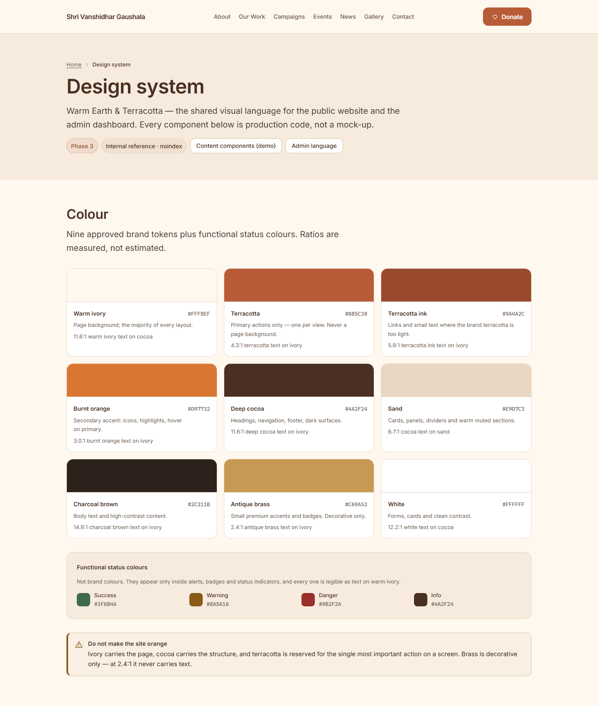
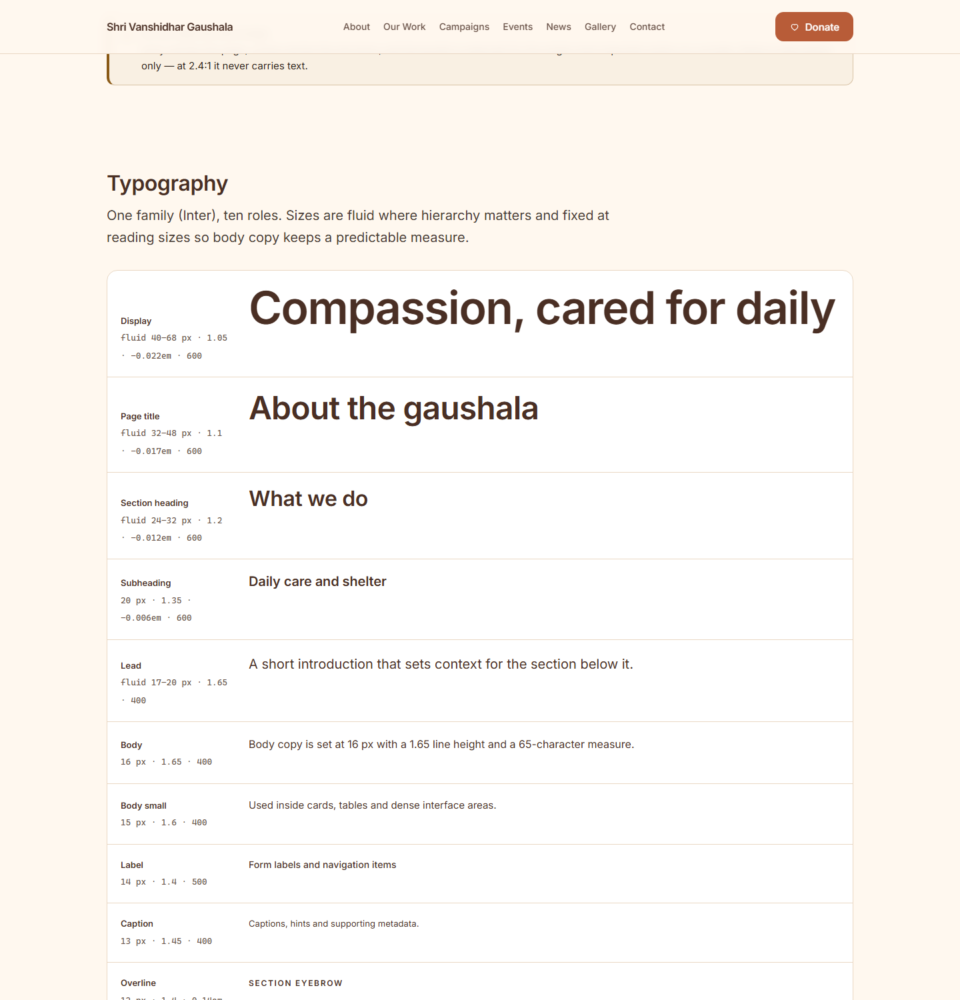
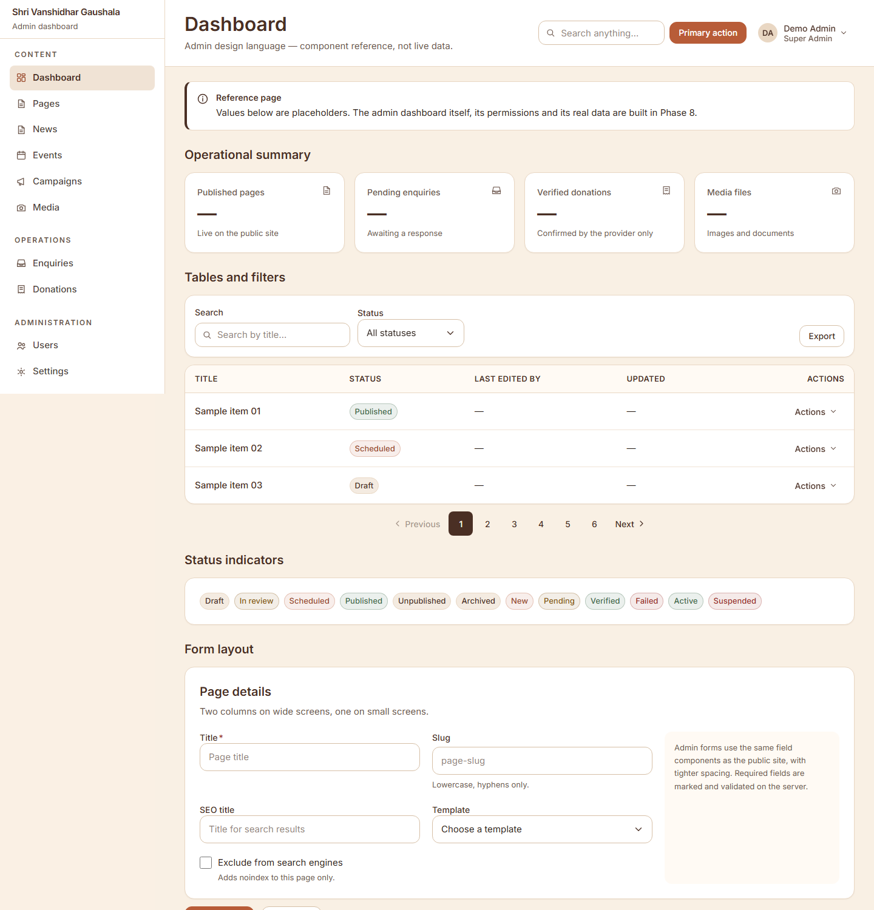
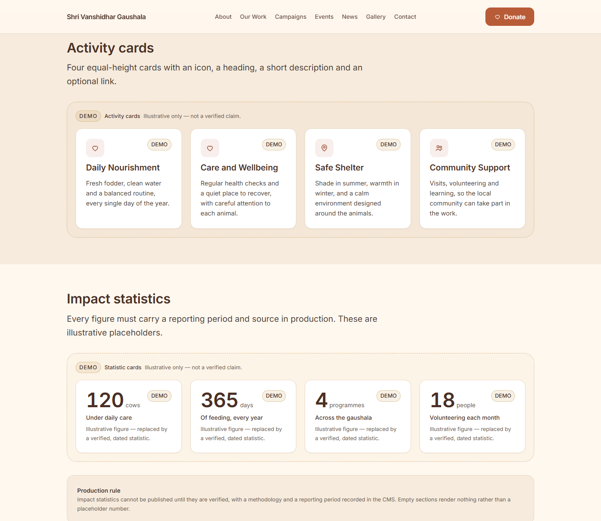
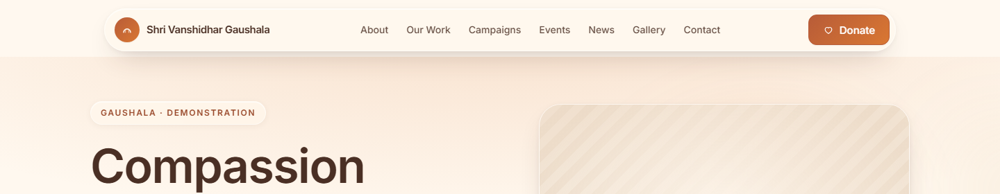
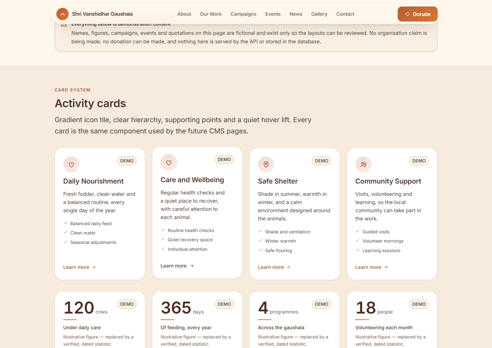
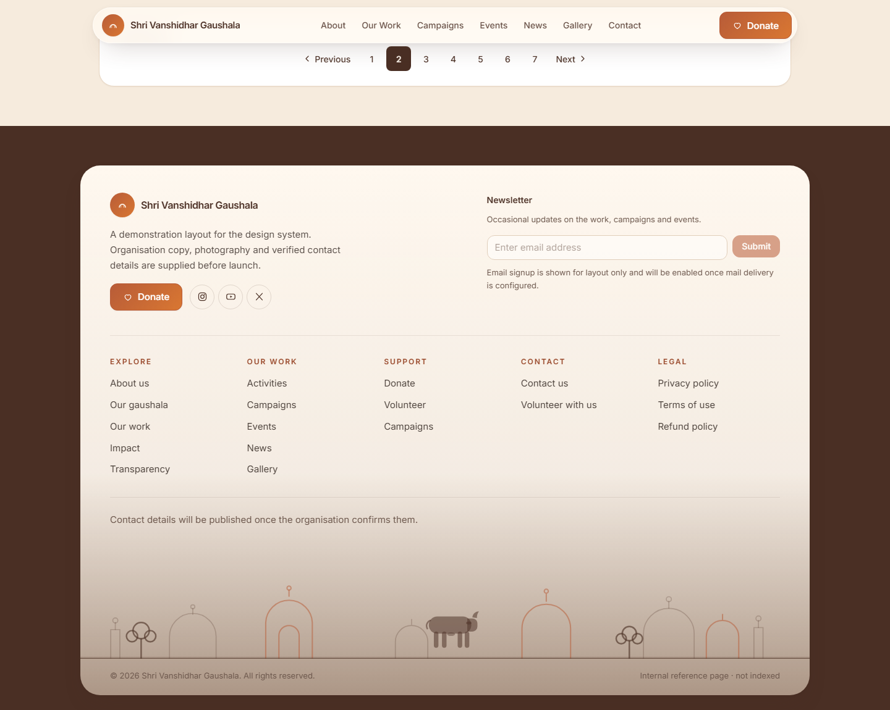

# Design System — Warm Earth & Terracotta

**Phase:** 3 · **Status:** complete, awaiting approval
**Living reference:** `/design-system` (public components) and `/design-system/admin` (admin language) — both `noindex`
**Source of truth:** `packages/shared/src/design/tokens.ts` + `apps/web/src/app/globals.css`



---

## 1. Principles

| Principle | What it means in practice |
|---|---|
| **Warm but not orange** | Ivory carries the page, cocoa carries the structure, terracotta marks one action per view. Brass is decorative only. |
| **Premium through restraint** | One typeface, one shadow family, generous whitespace, consistent radii. No gradients, no decorative borders, no animation for its own sake. |
| **Accessible by construction** | Field labels, error bindings, focus rings and contrast are built into components, not left to the caller. Tests assert the rendered markup. |
| **Truthful by default** | Image slots show a labelled placeholder until authentic photography exists. Status colours carry text, never colour alone. |
| **Token discipline** | No component contains a hex colour. `pnpm check:tokens` and an automated test enforce this. |

---

## 2. Colour

### 2.1 Brand palette (fixed by the blueprint §5)

| Token | Value | Use | Contrast |
|---|---|---|---|
| `--color-ivory` | `#FFF8EF` | Page background — the majority of every layout | 11.6:1 with cocoa text |
| `--color-terracotta` | `#B85C38` | Primary actions only; never a large background | 4.3:1 on ivory → **large text or surfaces only** |
| `--color-terracotta-ink` | `#9A4A2C` | Links and small text (accessibility companion) | 5.9:1 on ivory ✔ |
| `--color-burnt-orange` | `#D97732` | Secondary accent, icons, hover on primary | 3.0:1 on ivory → **not body text** |
| `--color-cocoa` | `#4A2F24` | Headings, navigation, footer, inverse surfaces | 11.6:1 on ivory ✔ |
| `--color-sand` | `#E9D7C3` | Cards, dividers, muted sections | 8.7:1 with cocoa text ✔ |
| `--color-charcoal` | `#2C211B` | Body text | 14.9:1 on ivory ✔ |
| `--color-brass` | `#C69A52` | Small accents and badges; **decorative only** | 2.4:1 on ivory ✘ |
| `--color-white` | `#FFFFFF` | Forms, cards, clean contrast | 12.2:1 with cocoa text ✔ |

**The terracotta rule.** Brand terracotta reaches only 4.3:1 on ivory — below WCAG AA for body text.
It is therefore used for *large surfaces and button fills*, and `--color-terracotta-ink` is used for
links and any small text. Both are tested.

### 2.2 Functional status colours

Not brand colours. They appear only in alerts, badges and status indicators.

| Token | Value | Meaning | Contrast on ivory |
|---|---|---|---|
| `--color-success` | `#3F6B4A` | Verified payment, published content | 5.8:1 ✔ |
| `--color-warning` | `#8A5A16` | Scheduled, pending, needs attention | 5.6:1 ✔ |
| `--color-danger` | `#9B2F2A` | Errors, destructive actions, failures | 7.0:1 ✔ |
| `--color-info` | `#4A2F24` | Neutral informational | 11.6:1 ✔ |

### 2.3 Supporting neutrals

| Token | Value | Use |
|---|---|---|
| `--color-muted` | `#6B564B` | Secondary text, captions, hints |
| `--color-border-strong` | `#D6BFA6` | Input borders (needs 3:1 against the surface) |

### 2.4 Semantic aliases

Components consume semantic names (`--color-background`, `--color-surface`, `--color-text-primary`,
`--color-link`, `--color-focus-ring`, …) so a future theme change is a one-file edit.


---

## 3. Typography

### 3.1 The family

**Inter** (variable, 100–900), self-hosted.

| Decision | Reason |
|---|---|
| Inter | Excellent legibility at 13–16 px, true tabular numerals for admin tables, wide weight range for display hierarchy, OFL licensed |
| Self-hosted, latin subset | 48 KB variable font committed at `apps/web/src/fonts/inter-latin-variable.woff2`. No request reaches Google at build or run time — better privacy and no third-party dependency |
| `next/font/local` | Fingerprinted filename, `<link rel="preload">`, `font-display: swap`, and a metric-matched fallback so the swap does not shift layout |
| Devanagari | `'Noto Sans Devanagari'` is already in the stack for the future Hindi launch (ADR-013). A subset ships with that launch rather than loading unused bytes now |

Fallback stack: `Inter → ui-sans-serif → system-ui → Segoe UI → Noto Sans Devanagari → Helvetica Neue → Arial → sans-serif`.

### 3.2 Scale

Ten roles. Sizes are fluid where hierarchy matters (display → lead) and fixed at reading sizes so
body copy keeps a predictable measure.

| Role | Utility | Size | Line height | Tracking | Weight |
|---|---|---|---|---|---|
| Display | `text-display` | clamp 40 → 68 px | 1.05 | −0.022em | 600 |
| Page title | `text-title` | clamp 32 → 48 px | 1.1 | −0.017em | 600 |
| Section heading | `text-heading` | clamp 24 → 32 px | 1.2 | −0.012em | 600 |
| Subheading | `text-subheading` | 20 px | 1.35 | −0.006em | 600 |
| Lead | `text-lead` | clamp 17 → 20 px | 1.65 | 0 | 400 |
| Body | `text-body` | 16 px | 1.65 | 0 | 400 |
| Body small | `text-body-sm` | 15 px | 1.6 | 0 | 400 |
| Label | `text-label` | 14 px | 1.4 | 0.005em | 500 |
| Caption | `text-caption` | 13 px | 1.45 | 0.005em | 400 |
| Overline | `text-overline` | 12 px | 1.4 | 0.14em | 600 |

Rules:

- **One `<h1>` per page**, set with `text-title`. Sections use `text-heading` on `<h2>`.
- **Measure:** prose is capped at `65ch` (`.measure-prose`); narrow aside text at `52ch`.
- Every role defines a line height — `pnpm check:tokens` fails the build otherwise.



---

## 4. Spacing, layout and shape

### 4.1 Spacing

4 px base step, with an 8 px visual rhythm for sections.

| Token | Value | Token | Value |
|---|---|---|---|
| `--spacing-1` | 0.25rem | `--spacing-8` | 2rem |
| `--spacing-2` | 0.5rem | `--spacing-12` | 3rem |
| `--spacing-3` | 0.75rem | `--spacing-16` | 4rem |
| `--spacing-4` | 1rem | `--spacing-20` | 5rem |
| `--spacing-6` | 1.5rem | `--spacing-24` | 6rem |

Section rhythm (`Section` component): `compact` 48/64 px, `default` 64/80/96 px,
`spacious` 80/96/128 px (mobile / tablet / desktop).

### 4.2 Containers

| Token | Width | Use |
|---|---|---|
| `--container-narrow` | 40rem | Auth and single-column forms |
| `--container-prose` | 45rem | Long-form policy pages |
| `--container-content` | 75rem | Default page container |
| `--container-wide` | 90rem | Admin tables, gallery grids |

Horizontal padding: 20 px mobile, 32 px ≥ 640 px, 40 px ≥ 1280 px.

### 4.3 Breakpoints (mobile-first, `min-width`)

| Token | Width | Typical layout |
|---|---|---|
| `xs` | 480 px | Large phone |
| `sm` | 640 px | Small tablet / landscape phone |
| `md` | 768 px | Tablet — two-column cards |
| `lg` | 1024 px | Desktop — full navigation, sidebar |
| `xl` | 1280 px | Wide desktop |
| `2xl` | 1440 px | Very wide |

360 px is the **minimum supported width**, not a breakpoint.

### 4.4 Radius, elevation, layering, motion

| Group | Values |
|---|---|
| Radius | `xs` 2px · `sm` 4px · `md` 8px · `lg` 12px · `xl` 16px · `2xl` 24px · `full` |
| Shadow | `soft` (cards) · `raised` (hover) · `elevated` (popovers) · `overlay` (dialogs) — all warm-tinted, never black |
| Z-index | `raised` 10 · `dropdown` 20 · `sticky` 30 · `backdrop` 40 · `modal` 50 · `toast` 60 · `skip-link` 70 |
| Motion | 150 ms (fast) · 200 ms (base) · 250 ms (slow); easing `standard`, `entrance`, `exit` |

All motion is disabled under `prefers-reduced-motion: reduce`.

---

## 5. Components

Every component lives in `apps/web/src/components` and is exported from `@/components/ui`,
`@/components/site` or `@/components/admin`.

### 5.1 Buttons

```tsx
<Button variant="primary" size="md">Save draft</Button>
<Button variant="secondary" iconLeft={<HeartIcon />}>Donate</Button>
<Button variant="ghost" size="sm">Cancel</Button>
<Button variant="danger">Delete</Button>
<Button isLoading>Saving</Button>
<ButtonLink href="/donate" iconLeft={<HeartIcon />}>Donate</ButtonLink>
```

- One `primary` per view. `danger` only for irreversible actions.
- Defaults to `type="button"` — a stray click can never submit a form.
- `isLoading` sets `aria-busy` and disables the control.
- Minimum target height 36/44/48 px by size; all ≥ WCAG 2.5.8 minimum.

### 5.2 Links

```tsx
<TextLink href="/about">Read about the gaushala</TextLink>
<TextLink href="https://example.com" external>Reference</TextLink>
<NavLink href="/news" isActive>News</NavLink>
```

Links are underlined by default — colour is never the only affordance. External links add
`target="_blank"`, `rel="noopener noreferrer"` and a screen-reader-only warning.

### 5.3 Form controls

```tsx
<Input name="email" type="email" label="Email address" required
       hint="Used only for receipts." error="Enter a valid email address." />

<Textarea name="message" label="Message" rows={4} />

<Select name="purpose" label="Donation purpose" placeholder="Choose one"
        options={[{ value: 'general', label: 'Where it is needed most' }]} />

<Checkbox name="consent" label="I agree to the privacy notice" description="Required." />

<RadioGroup name="contact" legend="How should we contact you?" options={[…]} />

<FormErrorSummary errors={[{ fieldId: 'email', label: 'Email address', message: 'Enter an email address.' }]} />
```

Guarantees, asserted by tests:

- every control is bound with `htmlFor`/`id` derived from `name` (pass `id` when a name repeats);
- `hint` and `error` are merged into `aria-describedby`;
- `error` sets `aria-invalid="true"` and a visible icon plus text;
- `required` is a real attribute, so assistive technology announces it;
- `FormErrorSummary` uses `role="alert"` and links each entry to its field.

### 5.4 Feedback

| Component | Behaviour |
|---|---|
| `Alert` | `danger`/`warning` use `role="alert"`; `info`/`success` use `role="status"` |
| `Spinner` | `role="status"` with a visually hidden label |
| `LoadingState` | Polite live region with message and optional description |
| `Skeleton` | `aria-hidden` decorative placeholder |
| `EmptyState` | Title, explanation and an optional next action |

### 5.5 Content and media

```tsx
<Card tone="default" padding="lg" interactive>…</Card>
<Badge tone="success">Published</Badge>
<SectionHeading eyebrow="Our work" title="What we do" description="…" level={2} />

<ImageContainer aspect="16/9" placeholderLabel="Campaign photograph" caption="…" />
```

`ImageContainer` reserves the aspect ratio (no layout shift) and renders a clearly-labelled
placeholder until authentic photography exists. Passing `src` without `alt` throws in development —
an unlabelled image cannot ship.

### 5.6 Navigation and structure

`Breadcrumbs`, `PageHeader`, `Container`, `Section`, `SkipLink`, `VisuallyHidden`, `Dialog`,
`ConfirmDialog`.

`Dialog` is built on the native `<dialog>` element opened with `showModal()`: focus trapping, `Escape`
and focus restoration come from the platform. Backdrop clicks close it and background scrolling is
locked while open.

### 5.7 Site chrome

`SiteHeader` (sticky, desktop nav, accessible mobile menu), `SiteFooter` (dark cocoa, contact slot),
`DonateCta`, `StickyDonateCta` (mobile-only, appears after 480 px of scrolling and is removed from the
DOM when hidden so it can never receive focus while invisible).

### 5.8 Admin language

Same tokens, optimised for throughput:

| Component | Purpose |
|---|---|
| `AdminShell` | Sidebar + content; horizontal section strip below `lg` |
| `AdminSidebar` | Grouped navigation with active state |
| `AdminHeader` | Page title, description, search and actions |
| `StatCard` | Metric with label, value, hint and trend |
| `DataTable` | Semantic table with caption, column scopes, horizontal scroll, empty row |
| `FilterBar` | Labelled search + filter and action slots |
| `StatusBadge` | Enum → human label + tone |
| `FormSection` | Grouped fields with an optional aside |
| `ConfirmDialog` | Names the object, danger action, cancel is always available |



### 5.9 Content cards

A shared surface (`CardSurface`) with seven content shapes. Every card is an `<article>` with a
caller-chosen heading level, an optional single stretched link, a reserved image aspect ratio and an
optional `demo` marker.

| Component | Shape |
|---|---|
| `ImageCard` | Image, eyebrow, title, description, meta and link |
| `ActivityCard` | Icon, title, description and optional link |
| `CampaignCard` | Cover image, status, purpose, progress bar, raised/goal amounts and link |
| `EventCard` | Date block (`<time>`), title, time, venue, status badge and link |
| `NewsCard` | Cover, category, date, title, excerpt and read link |
| `GalleryCard` | Square image with caption and category |
| `TestimonialCard` | Quote, attribution and demo marker |
| `StatisticCard` | Value, unit, label and the reporting note |

```tsx
<CampaignCard
  title="Winter Fodder Fund"
  purpose="Fodder through the coldest months."
  raisedMinor={18_000_000}
  goalMinor={50_000_000}
  status="Active"
  imageLabel="Campaign photograph"
  link={{ href: '/campaigns/winter-fodder', label: 'Support this campaign' }}
/>
```

Amounts are **integer minor units** (`18_000_000` paise = ₹1,80,000) formatted with `formatInr` from
`@gaushala/shared` — never pre-formatted strings, never floating-point rupees.

### 5.10 Divider, progress and pagination

```tsx
<Divider />
<Divider label="Or continue with" />
<ProgressBar value={250} max={1000} label="Campaign progress" showValue />
<Pagination currentPage={3} totalPages={10} hrefFor={(page) => `?page=${page}`} />
```

- `Divider` renders a semantic `<hr>` unless a label is supplied, in which case it becomes a labelled
  separator.
- `ProgressBar` exposes `role="progressbar"` with real bounds and an `aria-valuetext` percentage; the
  visual bar is decorative.
- `Pagination` uses real links (crawlable), marks the current page with `aria-current="page"` and
  disables the previous/next slot on the boundary without rendering a dead link.

### 5.11 Toasts and page states

```tsx
<Toast tone="success" title="Draft saved" onDismiss={dismiss} />
<ErrorState title="We could not load this page" description="…" reference="req_01HX4M2" action={…} />
<SuccessState title="Your message was sent" description="…" />
<FormSuccess description="Your draft was saved." />
```

Toasts are for transient confirmation of an action the user just took. Anything that must be read or
acted on belongs in the page as an `Alert` or an inline `FormSuccess`. `ErrorState` always offers a
way forward and shows a non-sensitive reference instead of an error message.

### 5.12 Admin action menu and account menu

```tsx
<ActionMenu label="Actions for this item" items={[…]} />
<UserMenu name="Asha Verma" role="Content Editor" />
```

`ActionMenu` is a real `role="menu"` with `aria-haspopup`/`aria-expanded`, arrow-key navigation,
`Home`/`End`, `Escape` to close and return focus, and click-outside dismissal. `UserMenu` builds on it
and shows identity (name and role) before the menu is opened.

---

## 6. Responsive behaviour

Mobile-first. Verified with `pnpm check:responsive`, which drives headless Chrome over the DevTools
protocol at 360/390/768/1024/1280/1440 px and fails if the document scrolls horizontally or any
element sticks out past the viewport.

| Region | Behaviour |
|---|---|
| Header | Wordmark + menu button below `lg`; full navigation and Donate button from `lg` |
| Hero / headings | Fluid type; measure capped so lines never become unreadable |
| Cards | 1 column → 2 at `md` → 3 at `lg` |
| Forms | Single column; two columns from `sm` inside cards |
| Tables | Horizontal scroll inside their own container, never the page |
| Footer | Stacked → 2 columns at `lg` |
| Sticky donate | Mobile only, below `md` |
| Admin | Sidebar from `lg`; horizontal section strip below it |

Latest run: **PASS at every width, zero overflowing elements** on both reference pages.

---

## 7. Accessibility

| Requirement | Implementation |
|---|---|
| 1.4.3 Contrast | All text pairs ≥ 4.5:1; audited in `tokens.test.ts` |
| 1.4.11 Non-text contrast | Focus ring and input borders ≥ 3:1 |
| 1.4.1 Use of colour | Status always has text plus an icon |
| 2.4.7 Focus visible | 2 px cocoa outline, 2 px offset, on every focusable element |
| 2.4.1 Bypass blocks | `SkipLink` to `#main-content` |
| 2.5.8 Target size | Controls ≥ 44 px on touch layouts |
| 3.3.1/3.3.3 Errors | Message next to the field, summary at the top, specific guidance |
| 4.1.2 Name, role, value | Native elements wherever possible; ARIA only to complete them |
| 2.3.3 Animation | All motion disabled under `prefers-reduced-motion` |
| 1.3.1 Info and relationships | `fieldset`/`legend`, `table`/`caption`/`scope`, labelled landmarks |

Keyboard-only and screen-reader spot checks were performed on the reference pages. A full axe-based
audit is a Phase 11 deliverable once the real pages exist.

---

## 8. Using the system

```tsx
import { Button, Card, SectionHeading } from '@/components/ui';
import { SiteHeader, SiteFooter, PRIMARY_NAV, FOOTER_NAV } from '@/components/site';
import { AdminShell, DataTable } from '@/components/admin';
```

Rules for contributors:

1. **Never write a hex colour.** Use a token utility (`bg-terracotta`, `text-cocoa`). A test scans
   `src/components`, `src/app` and `src/demo` and fails on any hex literal.
2. **Never re-implement a control.** If something is missing, add it to `components/ui` with a test.
3. **One `h1` per page**, sections use `SectionHeading`.
4. **Every image gets `alt`** — `ImageContainer` enforces it.
5. **Every input gets a label** — the field components make the unlabelled case impossible.
6. **No new UI dependency** without an entry in this document explaining what it replaces.
7. **Demo data stays in `src/demo`** and is imported only by `/design-system` routes — enforced by a
   test (see §9).

### Verification commands

```bash
pnpm check:tokens       # colours and typography in CSS match tokens.ts
pnpm check:responsive   # no horizontal overflow at six widths (needs a running server)
pnpm --filter @gaushala/web test:unit
pnpm capture --url http://127.0.0.1:3100/design-system --out docs/screenshots/example.png --width 1440
```

---

## 9. Demonstration content and production safeguards

The organisation has not yet supplied its history, logo, photographs, services, figures, events,
campaigns or contact details. To evaluate the design without inventing facts, the project separates
**illustrative demonstration content** from **real content** at the module level.

### 9.1 Where demo content lives

| Layer | Demo content? | Why |
|---|---|---|
| `apps/web/src/demo/content.ts` | **Yes** — the only place | Frontend-only module, versioned (`DEMO_CONTENT_VERSION`) |
| API (`apps/api`) | **No** | No demo endpoint, no demo seed, no demo table |
| Database | **No** | `prisma/seed.ts` seeds permissions, roles and settings only |
| Production pages (Phase 4+) | **No** | They read from the API, not from `src/demo` |
| `/design-system*` routes | **Yes** | Internal, `noindex` reference pages |

### 9.2 Marking rules

Every demo record carries `isDemo: true` and the shared `DEMO_NOTICE`, and everything rendered from it
is visibly marked three ways:

1. a **DEMO chip** on each card (`Badge` tone `accent`);
2. a **`DemoFrame`** wrapper with a dashed brass border and the sentence "Illustrative only — not a
   verified claim";
3. a **`data-demo="true"`** attribute for automated scanning.

A page-level `DemoBanner` appears at the top of every reference page that shows demo content.

### 9.3 What is never invented

| Category | Handling |
|---|---|
| Organisation achievements | Only illustrative counts, each labelled "Illustrative figure" |
| Registration / legal / tax claims | Not present anywhere |
| Testimonials | Fictional, attributed to "Demo supporter", marked "not a real person" |
| Contact details | Deliberately empty; the block states details are published after verification |
| Photographs | Labelled placeholders — no stock image is presented as the Gaushala |
| Campaigns | Marked "Illustrative"; no donation control is rendered on demo pages |
| SEO metadata | Demo titles and descriptions carry "(demo)" / "illustrative" |

### 9.4 Enforced safeguards

`apps/web/src/demo/demo.test.ts` fails the build if any of these stop being true:

- every demo record is marked and shares the notice;
- **only** `src/app/design-system/**` imports `@/demo` (no production route can);
- no shared component imports `@/demo`;
- the API seed contains no demo markers;
- contact details remain empty and testimonials/statistics stay labelled;
- campaign amounts stay integer minor units.

The design-system routes are `noindex` and are excluded from the public navigation. When the site
launches, they are either removed or protected by authentication.

### 9.5 Replacing demo content with real content

Demo content is **not** a scaffold for the CMS. Real content arrives through the API and the CMS in
Phases 4–10; the demo module is then deleted. Because every component takes its content as props,
replacing the data source requires no component changes.



---

## 10. Premium surface system

The visual redesign adds depth without leaving the palette. Everything below is expressed as tokens in
`tokens.ts` and mirrored in `globals.css` (`pnpm check:tokens` verifies colours, typographic roles and
gradient names).

### 10.1 Glass

| Token | Value | Use |
|---|---|---|
| `--color-glass` | `rgba(255,248,239,0.72)` | Floating header, overlays, small panels |
| `--color-glass-strong` | `rgba(255,248,239,0.88)` | Panels carrying real copy |
| `--color-glass-dark` | `rgba(44,33,27,0.55)` | Glass over photography or dark surfaces |
| `--color-glass-border` | `rgba(255,255,255,0.55)` | Fine light border |
| `--blur-glass` / `--blur-glass-strong` | `18px` / `28px` | Backdrop blur steps |

Utilities: `.glass`, `.glass-strong`, `.glass-dark`. Each carries a 1 px inner white highlight so the
surface reads as lit, and a **solid ivory fallback** inside `@supports not (backdrop-filter)`. Glass is
used for the header pill, campaign status pills, hero stat card, dialogs and small panels — never for
whole sections, so solid surfaces still carry the page.

### 10.2 Ambient gradients

| Token | Purpose |
|---|---|
| `--gradient-hero-bloom` | Wide warm bloom behind a hero |
| `--gradient-hero-glow` | Offset brass glow for asymmetry |
| `--gradient-card-sheen` | Top light on card surfaces |
| `--gradient-icon-tile` | Icon tile and date tile fill |
| `--gradient-cta` | Primary action fill (terracotta → burnt orange) |

Gradients are accents: they sit behind content, never as a full-page wash, and text always sits on a
surface with a measured contrast ratio.

### 10.3 Elevation and motion

| Token | Value |
|---|---|
| `--shadow-glass` | Wide ambient shadow + tight contact shadow |
| `--shadow-lifted` | Hover elevation for cards |
| `.hover-lift` | `translateY(-4px)` + lifted shadow on hover/focus-within |
| `.media-zoom img` | `scale(1.045)` on card hover, 600 ms |
| `.cta-gradient` | Gradient fill with filter/shadow transitions on hover and active |
| `.reveal-up` (+ `-1`, `-2`, `-3`) | 620 ms staggered hero entrance |

All of it is disabled by the global `prefers-reduced-motion` rule, and nothing animates on keyboard
focus in a way that could obscure content.

### 10.4 Redesigned composition

- **Header** — a floating glass pill (max 1180 px) that compacts on scroll, with the brand mark, centred
  navigation and a gradient Donate action; mobile navigation stays a native modal dialog.
- **Hero** — `Hero` component: eyebrow pill, display heading, lead, two actions, image panel with a
  floating glass stat card and a labelled placeholder.
- **Cards** — 2xl radius, sand hairline border, soft shadow, top sheen, gradient icon/date tiles,
  optional bullet lists, image zoom and a 4 px hover lift.
- **Footer** — cocoa surround holding an ivory panel: brand, newsletter foundation (disabled with an
  explanation), five link columns, verified-contact slot, an original heritage skyline illustration and
  a quiet legal bar.





---

## 11. Deliberate omissions

| Not built | Phase |
|---|---|
| Accordion, tabs and tooltip | When a real screen needs them (5/8) — adding them now would be speculative |
| Dark mode | Not requested; tokens are structured to allow it |
| Hindi font files | Ships with the Hindi launch (ADR-013) |
| Full axe audit | Phase 11, once real pages exist |
| Admin drawer navigation below `lg` | Phase 8, with the real admin shell |
| Real CMS editing, publishing or donations | Phases 6–9 |
